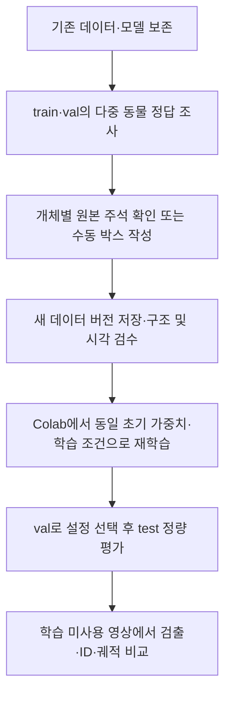

# 지능형 객체 추적 시스템

YOLO11n으로 사람을 검출하고, **직접 구현한 ByteTrack과 그 개선판**으로 프레임 간 같은 객체에 같은 ID를 유지하는
다중 객체 추적 시스템입니다. 추적 결과·성능 비교는 PySide6 GUI로 확인합니다.

* 과제 요구 사항 10개와 구현 대응표: [`docs/REQUIREMENTS.md`](docs/REQUIREMENTS.md)
* MOT17 보행자 추적 결과: [`docs/MOT17_RESULTS.md`](docs/MOT17_RESULTS.md)
* ByteTrack 원리와 개선 내용: [`docs/BYTETRACK.md`](docs/BYTETRACK.md)
* 협업 규칙(두 사람·두 AI)과 확장 기능 만드는 법: [`docs/COLLABORATION.md`](docs/COLLABORATION.md), [`AGENTS.md`](AGENTS.md)

| 데이터셋 | 용도 | 결과 가중치 |
|---|---|---|
| [COCO](https://cocodataset.org/#download) | 사람·고양이·개·새 검출 학습 (선택, 전체 학습 미실행) | `models/coco.pt` (없음, GUI는 사람만 사용) |
| [MOT17](https://motchallenge.net/data/MOT17/) · [MOT20](https://motchallenge.net/data/MOT20/) | 보행자 추적 평가(HOTA·IDF1·MOTA·IDSW), 파라미터 튜닝, 검출기 학습 | **`models/person.pt` (기본 검출기)**, MOT17로 학습. MOT20은 미실행 |
| [CrowdHuman](https://www.crowdhuman.org/download.html) | 사람이 많이 겹치는 장면의 사람 검출 | `models/person_crowdhuman.pt` (96장 소량 실험, 기본 아님) |
| [WIDER FACE](http://shuoyang1213.me/WIDERFACE/) | 얼굴 검출 → 자동 모자이크 (확장 기능) | `models/face.pt` (96장 소량 학습) |

## 설치와 실행 (Windows)

Python 3.11 이상을 권장합니다. 프로젝트 폴더의 PowerShell에서:

```powershell
python -m venv .venv
& ".\.venv\Scripts\python.exe" -m pip install -r .\requirements.txt
& ".\.venv\Scripts\python.exe" .\main.py
```

## GUI 사용법

1. **영상 열기**로 파일을 고르거나, 번호를 정하고 **카메라 연결**을 누릅니다.
2. **검출 모델**, **추적기**(ByteTrack 기본 / 개선 / 튜닝 설정), **얼굴 모자이크**, **확장 기능**을 고르고 **▶ 시작**을 누릅니다.
3. 화면에 박스·ID·이동 궤적이 그려지고, 가려지거나 화면 밖으로 나간 객체는 점선 회색 박스로 표시됩니다.
   오른쪽 목록에서 객체별 상태(추적 중·가림·화면 이탈·재등장·재진입), 이동 방향, 누적 거리, 속도를 확인합니다.
   위쪽에는 현재 FPS, 평균 FPS·평균 ms, 단계별(검출·추적·모자이크) 시간이 나옵니다.
4. **일시정지 → 시작**은 이어서, **중지 → 시작**은 처음부터 추적합니다.
5. 추적이 끝나면 **결과 저장**으로 CSV(+설정 JSON)를 저장하고, **결과 불러오기**로 모델 없이 다시 재생할 수 있습니다.
6. **설정 저장/불러오기**는 모델·추적기·대상·표시 옵션을 JSON으로 저장합니다.
7. **성능 비교** 탭은 `run_mot.py`, `benchmark_speed.py`가 만든 비교표를 보여 줍니다.
8. **보호색 추적** 탭은 보호색 동물 전용 데이터 미리보기, 모델 정보, 영상 추적과 **보호색 학습 비교** 창을 엽니다 (`docs/CAMOUFLAGE_WORKSPACE.md`).
   실시간 추적 탭이 영상을 처리하는 동안에는 보호색 탭의 추적 실행과 학습 비교가 잠기고, 반대로 보호색 탭이 처리하는 동안에는 실시간 추적을 시작하지 않습니다.

검출 모델 기본값은 `models/person.pt` → `models/coco.pt` → `yolo11n.pt` 순서로 고릅니다.
`models/person.pt`는 MOT17로 학습한 **사람 전용** 모델이라, 실시간 추적 탭의 추적 대상은 **사람**만 고를 수 있습니다.
(예전에는 고양이·개·새도 화면에 있었지만 기본 모델에서는 시작할 때 오류가 나서 뺐습니다. 예전 설정 파일을 불러오면 사람만 적용됩니다.)
검출 모델 목록의 `hangul_jamo.pt`, `camouflage.pt`는 확장 기능 전용이라 실시간 추적 탭의 검출 모델로 고르면 "없는 클래스" 오류가 납니다.
얼굴 모자이크는 처리 시간을 약 2배로 늘리므로 속도를 보여 줄 때는 끄고 실행하세요 (`sample.mp4`, CPU: 켬 약 100 ms, 끔 약 46 ms/프레임).

## 파일 구성

| 파일 | 역할 | 요구 사항 |
|---|---|---|
| `tracker/` | ByteTrack 직접 구현(칼만 필터, 헝가리안 연결, 상태 관리)과 개선 기능, 이동 정보 계산 | 2·3·4·5 |
| `pipeline.py` | 검출 → 외형 특징 → 추적 → 얼굴 모자이크를 묶은 처리 파이프라인 | 8 |
| `main.py`, `tracking.py` | GUI와 영상·카메라 처리 스레드 | 8·9 |
| `results_io.py` | 추적 결과 CSV/MOT 저장·불러오기 | 10 |
| `prepare_dataset.py` | 4개 데이터셋 train/val/test 분할과 전처리 | 1 |
| `train_models.py` | YOLO11n Fine-tuning, test 평가, 가중치·설정 설치 | 6·10 |
| `run_mot.py` | MOT 시퀀스에서 추적기별 성능 측정 → 비교표 | 3·7·9 |
| `tune_params.py` | 검출·연관성 임계값, 추적 유지 시간 격자 탐색 | 6 |
| `analyze_failures.py` | ID 변경·끊김 사례를 교차·가림·화면 경계로 분류, 사례 이미지 | 4·7 |
| `benchmark_speed.py` | 처리 시간·FPS와 속도 영향 요인 측정 | 8 |
| `metrics.py` | HOTA·MOTA·IDF1·IDSW 계산 (TrackEval과 같은 값 확인) | 7 |
| `evaluate_mot.py` | 공식 TrackEval 교차 확인 (선택) | 7 |
| `extensions/` | 확장 기능 (한글 인식, 보호색 동물). 파일 하나 + `REGISTRY` 한 줄로 GUI·결과 파일에 자동 연결 | 확장 |
| `hangul_dataset.py`, `evaluate_hangul.py` | 한글 자모 확장 기능의 합성 데이터 생성, 추적·분류 평가 (`docs/HANGUL.md`) | 확장 |
| `tests/` | 단위 테스트와 정답을 아는 합성 장면 | — |

## 전체 실행 순서

아래 명령은 PowerShell 기준이며 `python`은 `.\.venv\Scripts\python.exe`로 바꿔 실행하세요.

### 1) 데이터 준비 (요구 사항 1)

내려받은 원본은 모두 `datasets/raw/` 아래에 풉니다. `datasets/`는 `.gitignore`에 들어 있어 수십 GB 데이터가 git에 잡히지 않고,
전처리 결과(`datasets/mot`, `datasets/coco4`, `datasets/crowd`, `datasets/face`)와도 폴더가 겹치지 않습니다.

```
datasets/raw/
├─ MOT17/train/MOT17-02-FRCNN/{img1, gt, seqinfo.ini} ...   (MOT17.zip)
├─ MOT20/train/...                                          (MOT20.zip, 선택)
├─ coco/{train2017, val2017, annotations}                   (선택)
├─ crowd/{train/Images, val/Images, annotation_train.odgt, annotation_val.odgt}  (선택)
└─ wider/{WIDER_train, WIDER_val, wider_face_split}          (선택)
```

MOT17·MOT20은 공식 ZIP의 `train` 폴더를 사용합니다 (test는 정답이 공개되지 않음).

```powershell
python prepare_dataset.py mot --sequences datasets/raw/MOT17/train datasets/raw/MOT20/train --output datasets/mot
python prepare_dataset.py coco --train-images datasets/raw/coco/train2017 --train-labels datasets/raw/coco/annotations/instances_train2017.json --val-images datasets/raw/coco/val2017 --val-labels datasets/raw/coco/annotations/instances_val2017.json --output datasets/coco4
python prepare_dataset.py crowd --train-images datasets/raw/crowd/train/Images --train-labels datasets/raw/crowd/annotation_train.odgt --val-images datasets/raw/crowd/val/Images --val-labels datasets/raw/crowd/annotation_val.odgt --output datasets/crowd
python prepare_dataset.py face --train-images datasets/raw/wider/WIDER_train/images --train-labels datasets/raw/wider/wider_face_split/wider_face_train_bbx_gt.txt --val-images datasets/raw/wider/WIDER_val/images --val-labels datasets/raw/wider/wider_face_split/wider_face_val_bbx_gt.txt --output datasets/face
```

MOT20을 받지 않았으면 첫 줄에서 `datasets/raw/MOT20/train`을 빼세요.
CrowdHuman은 `CrowdHuman_train01~03.zip`의 이미지를 `datasets/raw/crowd/train/Images` 하나에 모으고, `CrowdHuman_val.zip`은 `datasets/raw/crowd/val/Images`로 풉니다.
COCO는 `--limit 5000`처럼 분할당 이미지 수를 제한해 빠르게 실험할 수 있습니다.
기본 `yolo11n.pt`가 이미 COCO로 학습된 모델이므로 COCO 학습은 선택입니다. GUI는 사람만 추적합니다.

### 2) 검출기 Fine-tuning (요구 사항 6)

```powershell
python train_models.py coco  --data datasets/coco4/dataset.yaml --weights yolo11n.pt --epochs 30 --install
python train_models.py crowd --data datasets/crowd/dataset.yaml --weights yolo11n.pt --epochs 30
python train_models.py mot   --data datasets/mot/dataset.yaml   --weights yolo11n.pt --epochs 30
python train_models.py face  --data datasets/face/dataset.yaml  --weights yolo11n.pt --epochs 30 --install
```

CUDA가 있으면 `--device 0`을 붙이고, `--workers 4`로 데이터 로딩을 병렬화하면 GPU를 더 잘 씁니다.
GPU가 없으면 아래 "Google Colab에서 학습하기"를 참고하세요. `--install` 없이 학습한 가중치는 아래 3)에서 `--weights`로 비교한 뒤
좋은 쪽을 `models/person.pt`로 복사하세요 (`--install`은 기존 파일을 날짜를 붙여 백업합니다).

### Google Colab에서 학습하기

[`colab/train_mot17.ipynb`](colab/train_mot17.ipynb)를 Colab에서 열고(파일 → 노트북 업로드, 또는 GitHub 탭에서 이 저장소 선택)
**런타임 → 런타임 유형 변경 → GPU**를 고른 뒤 위에서부터 차례로 실행합니다.
MOT17 내려받기, 전처리, Fine-tuning 전 성능 측정, 학습, 학습 전후 비교, 파라미터 튜닝, 최종 비교, 실패 분석까지 진행하고
결과(`models/person.pt`+`.json`, `configs/tuned.json`, `results/`)를 Google Drive의 `AI_Project_Level_3_outputs/`에 저장합니다.
이 폴더의 내용을 내 PC 프로젝트 폴더에 같은 경로로 복사하면 GUI의 모델 목록·추적기 목록·성능 비교 탭에 그대로 나타납니다.
처리 속도(요구 사항 8)는 발표 PC에서 `benchmark_speed.py`로 따로 측정하세요.

### 확장: 떠다니는 한글 자모 추적 (담당 Pdint)

화면을 떠다니는 한글 자음·모음을 하나씩 검출·추적하고 어떤 자모인지 표시하는 확장 기능입니다.
`models/hangul_jamo.pt`가 있으면 GUI의 **확장 → 한글 자모** 체크박스로 켭니다 (화면 표시 예: `자3 ㄱ`).
자모가 모여 글자 모양이 되면 **단어로 읽어 함께 표시**합니다 (예: `자1001 한글`).
**시연**: GUI에서 `hangul_demo.mp4`를 열고 **확장 → 한글 자모**를 켠 뒤 시작하면, 떠다니던 자모가 "한글"과 "객체추적"으로 모였다 흩어집니다.
설계와 진행 상황은 [`docs/HANGUL.md`](docs/HANGUL.md)에 있습니다. 학습·평가 데이터는 정답을 아는 **합성 데이터**를 직접 만듭니다.

```powershell
python hangul_dataset.py --output datasets/hangul        # 검출 이미지 + 떠다니는 자모 영상 (40클래스, 회전 ±45°)
python train_models.py hangul --data datasets/hangul/dataset.yaml --fliplr 0 --epochs 50 --install   # → models/hangul_jamo.pt
python evaluate_hangul.py datasets/hangul/tracking/test --trackers baseline improved --name test      # 추적 지표 + 자모 분류 정확도
python hangul_demo.py --words 한글 객체추적 --output my_demo.mp4                                        # 시연 영상 새로 만들기
```

* 좌우를 뒤집으면 ㅏ가 ㅓ가 되므로 학습할 때 반드시 `--fliplr 0`을 줍니다.
* Windows는 맑은 고딕 등 기본 글꼴, Linux·Colab은 `fonts-nanum`을 씁니다. GPU 학습은 [`colab/train_hangul.ipynb`](colab/train_hangul.ipynb)를 쓰세요.

### 3) 추적 성능 비교와 튜닝 (요구 사항 3·6·7)

```powershell
# val 구간에서 파라미터 탐색 → configs/tuned.json
python tune_params.py datasets/mot/tracking/val --base improved --name tuned

# test 구간에서 기본판 / 개선판 / 튜닝판 비교 → results/comparison.json (GUI 성능 비교 탭)
python run_mot.py datasets/mot/tracking/test --trackers baseline improved tuned --name test

# 개선 항목별 효과 (ablation)
python run_mot.py datasets/mot/tracking/test --trackers baseline baseline+appearance baseline+recover_lost baseline+reid_buffer --name ablation

# 검출 모델 비교 (같은 추적기, 가중치만 다르게)
python run_mot.py datasets/mot/tracking/test --weights training_runs/crowd/weights/best.pt --trackers improved --name crowdhuman

# 가림·교차 실패 사례 분석 → results/failures/test/
python analyze_failures.py datasets/mot/tracking/test --trackers baseline improved --name test
```

### 4) 처리 속도 (요구 사항 8)

```powershell
python benchmark_speed.py sample.mp4 --frames 150
```

### 테스트

```powershell
python -m unittest discover -s tests -t .
```

## 검증한 내용과 한계

* `metrics.py`의 HOTA·DetA·AssA·MOTA·IDF1·IDSW·Frag가 공식 TrackEval과 소수점 셋째 자리까지 같음을 합성 시퀀스로 확인했습니다.
* 정답을 아는 합성 장면(교차·기둥 가림·화면 이탈 후 재진입)에서 개선판은 IDSW 1 → 0, IDF1 90.30 → 96.17, HOTA 84.00 → 87.23입니다.
  다만 이 장면에서 효과를 낸 것은 재진입 ID 복원뿐이었습니다. 외형 연결과 가림 후 재연결의 효과는 **MOT 데이터에서 확인해야 합니다.**
* **MOT17 보행자 추적 결과**는 [`docs/MOT17_RESULTS.md`](docs/MOT17_RESULTS.md)에 있습니다. 검출기 Fine-tuning으로 test HOTA 40.88 → 51.46.
  MOT20, COCO, CrowdHuman, WIDER FACE 전체 학습·평가 수치는 아직 없습니다.
* ID는 영상 안에서만 유효한 번호입니다. 외형 특징은 색 히스토그램이라 옷 색이 비슷한 사람끼리는 구분력이 떨어집니다.
* 얼굴 모자이크는 검출된 얼굴에만 적용되고, 원본 재생·결과 재생 모드에는 적용되지 않습니다.

### 이전 실험 기록

| 가중치 | 데이터 | 설정 | 검증 mAP50–95 |
|---|---|---|---:|
| `experiments/crowdhuman_person.pt` | CrowdHuman 96 / 32장 | 4에폭, 크기 256 | 0.154 |
| `models/face.pt` | WIDER FACE 96 / 32장 | 4에폭, 크기 384 | 0.197 |
| `experiments/coco128_1epoch.pt` | COCO128 96 / 32장 | 1에폭, 크기 256 | 0.359 (기본 YOLO11n 0.385) |

MOT17-02-FRCNN 첫 60프레임에서 Ultralytics 내장 ByteTrack으로 측정한 HOTA는 기본 YOLO11n 38.40%, CrowdHuman 소량 학습본 10.29%였습니다.
CrowdHuman 가중치(`models/person_crowdhuman.pt`)는 이 결과 때문에 기본값으로 쓰지 않으며, GUI 모델 목록에서 직접 고를 수 있습니다.
얼굴 가중치는 [akanametov/yolo-face](https://github.com/akanametov/yolo-face/releases/tag/1.0.0)의 YOLO11n 얼굴 가중치에서 시작했습니다.

## 확장: 보호색 동물 추적 (kumohyunho / Codex)

학습에 사용하지 않은 영상에서 배경과 구분하기 어려운 동물을 검출하고, 개체별 ID와 이동 궤적을 유지하는 것이 목표입니다.
COCO 사전학습 YOLO11n을 COD10K·MoCA 검출 정답으로 파인튜닝하며, ByteTrack은 검출 결과를 연결합니다.
클래스는 **`0: camouflaged_animal` 하나**입니다. 개·고양이·새 등을 종별 클래스로 분류하지 않으며, 같은 클래스 안의 개체를 서로 다른 추적 ID로 구분합니다.

> **보호색 영상 전용**: 보호색 동물 데이터에는 사람이 나오는 장면이 없어서, 사람이 나오는 일반 영상에서는 사람을 동물로 잘못 검출합니다.
> `sample.mp4`(거리 보행자 영상)에서 실시간 추적 탭의 보호색 확장을 켜면 300프레임 중 292프레임에서 걷는 사람 무리를 `camouflaged_animal`로 표시했습니다(신뢰도 최대 0.82).
> 그래서 보호색 추적은 **보호색 동물 영상에만** 쓰고, 일반 영상의 사람 추적과는 따로 시연합니다.

### 진행 현황 (2026-11-17)

| 단계 | 현재 상태 | 근거·확인 범위 |
|---|---|---|
| 데이터 확보·전처리 | COD10K·MoCA 이미지와 YOLO 정답 준비 | 사용자 Colab 출력: train 8,096 / val 1,382 / test 3,198장. 데이터는 GitHub에 포함하지 않음 |
| 첫 파인튜닝 | Colab GPU에서 3에폭 학습 완료 | 초기 학습률 0.0005, 크기 640, 배치 8. [`models/camouflage.json`](models/camouflage.json)에 기록 |
| 가중치·설정 설치 | 저장소에 모델 쌍 포함 | [`models/camouflage.pt`](models/camouflage.pt), [`models/camouflage.json`](models/camouflage.json) |
| 영상 추적·GUI | 사용자 Windows GUI에서 박스·ID·궤적 출력 확인 | 갑오징어·개·고양이 영상 관찰. 정확도 평가 완료를 의미하지 않음 |
| NMS 비교 | IoU 0.3과 0.7로 영상 비교 | 갑오징어의 중복 박스는 0.3에서 감소했으나, 겹친 개·고양이의 개별 검출은 0.7에서도 실패 사례 확인 |
| 진단 기록 | 작업 브랜치에서 저장·재생 확인 | NMS 이후 검출 후보와 실제 출력 트랙을 같은 프레임에서 비교 |
| 학습 정답 점검 | 여러 동물을 한 박스로 묶은 사례 확인 | COD10K `foreground_union` 전처리와 실제 정답 미리보기 확인 |
| 개체별 정답 수정 | 주석 작업용 사본 준비 완료 | 해마·오리 train 이미지 2장과 기존 라벨을 ZIP으로 Drive에 보존. 새 박스 작성·검수는 아직 미완료 |
| 수정 데이터 재학습·정량 평가 | 미실행 | 개체별 정답 수정 후 기존 모델과 동일 조건 비교 필요 |

첫 모델의 저장된 **검출 평가 기록**은 다음과 같습니다. 이번 문서 작성 중 재측정한 값이 아니며, 개체별 정답을 수정하기 전 데이터 기준입니다.

| 분할 | mAP50 | mAP50–95 |
|---|---:|---:|
| val | 63.54% | 39.66% |
| test | 52.98% | 29.04% |

이 값은 추적 HOTA·IDF1·MOTA가 아니며, 다중 동물을 개별 검출하는 성능을 보장하지 않습니다.
개체 ID 정답에 기반한 실제 동물 추적 성능 평가는 **미실행**입니다.

### GUI·Colab 사용 범위

| 목적 | 필요한 파일·환경 |
|---|---|
| 새 영상 추적 | `camouflage.pt` + 같은 이름의 학습 설정 `.json` + 원본 영상. 학습 데이터 다운로드 불필요 |
| 학습 이미지·정답 확인 | 이미지·라벨이 함께 있는 데이터 폴더의 `splits.json` 또는 `dataset.yaml` 선택 |
| GUI에서 학습률별 재학습 | 실제 train/val 이미지·라벨과 초기 가중치 필요. 학습률 변경은 재학습이며 기존 모델 결과를 즉시 변경하지 않음 |
| Colab GPU 재학습 | Drive 백업을 Colab 로컬 공간에 복원하여 사용. PC에는 생성된 모델·설정만 가져와 영상 추적 가능 |

왼쪽 `학습(train) / 검증(val) / 테스트(test)` 선택은 **정답 이미지 열람용**이며, 실행 중인 영상의 학습 모드를 바꾸지 않습니다.
NMS IoU는 YOLO 검출 후 겹친 후보를 제거하는 추론 설정입니다. ByteTrack의 연결 임계값이나 학습률과 다릅니다.
NMS를 낮추면 중복 후보가 줄어들 수 있지만, 가까이 있는 서로 다른 동물의 정상 박스도 제거할 수 있습니다.

진단 기능이 포함된 브랜치에서는 `진단 기록 저장`을 체크하고 **추적을 새로 실행**한 뒤 `진단 영상 재생`·`진단 요약 열기`로 확인합니다.
`runs/camouflage/gui_<실행번호>/`에 `tracked.mp4`, `tracks.csv`, 실행 설정과 함께
`diagnostic.mp4`, `diagnostic_frames.jsonl`, `diagnostic_events.csv`, `summary.json`, `report.html`을 저장합니다.
진단 영상 왼쪽은 NMS 이후 검출 후보, 오른쪽은 출력 트랙입니다. 낮은 신뢰도의 후보 박스가 있다고 해서 새 ID가 생성된 것은 아닙니다.
진단은 검토할 의심 구간을 찾는 기능이며, 정답 기반 오탐률·IDSW 점수를 자동 확정하지 않습니다.

### 발견한 정답 문제와 다음 작업

사용자 Colab에서 복원한 `splits.json`의 박스 개수 분포는 COD10K **5,059장 모두 1개**, MoCA **7,617장 모두 1개**였습니다.
현재 데이터에는 이미지당 정답 박스가 여러 개인 사례가 없습니다. 단, 이것만으로 모든 이미지에 여러 동물이 있다고 판단하지는 않습니다.
[`camouflage_dataset.py`](camouflage_dataset.py)의 기본 `foreground_union`은 이진 마스크의 전경 전체를 감싸므로, 여러 동물이 같은 전경에 있으면 하나의 정답 박스가 됩니다.

| 확인한 이미지 | 분할 | 관찰 결과·처리 방침 |
|---|---|---|
| `cod_COD10K-CAM-1-Aquatic-7-Flounder-290.jpg` | test | 물고기 두 마리가 정답 박스 하나에 포함. train으로 이동하지 않고 테스트 사례로 유지 |
| `cod_COD10K-CAM-1-Aquatic-15-SeaHorse-1040.jpg` | train | 여러 해마 영역을 포함하는 큰 박스. 가림과 개체 범위를 확인한 뒤 개별 주석 필요 |
| `cod_COD10K-CAM-2-Terrestrial-30-Duck-1874.jpg` | train | 어미·새끼 오리를 한 박스로 묶음. 식별 가능한 개체마다 주석 필요 |

개·고양이 진단에서는 여러 동물을 감싼 큰 박스와 낮은 신뢰도의 작은 후보가 함께 나왔고, 붉은 통에도 낮은 신뢰도 오탐 후보가 생겼습니다.
이 관찰은 개별 검출 능력과 정답 품질을 점검해야 한다는 근거이며, 학습률이나 추적기 하나만을 원인으로 확정하지 않습니다.
이진 마스크에 `instance` 옵션만 켜도 개체가 자동 분리되지는 않습니다. 연결 성분도 가려진 한 동물의 몸 조각과 서로 다른 동물을 구분하지 못할 수 있습니다.



현재 Drive에는 사용자 확인 기준으로 `detection_data.tar.gz` 백업과 주석 작업용 `instance-review-fb1f0966.zip`이 있습니다.
주석 ZIP의 `images/`는 CVAT 등에 올릴 이미지이고, `original_labels/`는 비교용 기존 정답입니다.
라벨 `camouflaged_animal` 하나로 동물마다 박스를 작성하되, 여러 동물을 묶은 큰 박스는 새 정답에서 교체합니다.
기존 데이터에 바로 덮어쓰지 않고 새 버전으로 보존·검수합니다. 두 장의 수정만으로 전체 문제가 해결됐다고 보고하지 않습니다.
별도 영상도 정량 평가하려면 개체별 박스·ID 정답이 필요하며, 비교용 test 이미지·영상은 학습에 넣지 않습니다.

### 코드·PR 위치

main에는 학습·검사·학습률 비교, [#25 전용 화면](https://github.com/kumohyunho/AI_Project_Level_3-main/pull/25),
[#26 탭 연결](https://github.com/kumohyunho/AI_Project_Level_3-main/pull/26),
[#27 추적기 진단](https://github.com/kumohyunho/AI_Project_Level_3-main/pull/27),
[#28 보호색 진단 저장](https://github.com/kumohyunho/AI_Project_Level_3-main/pull/28)이 모두 들어 있습니다.
#26~#28은 처음에 작업 브랜치끼리 합쳐졌고, [#32](https://github.com/kumohyunho/AI_Project_Level_3-main/pull/32)로 main에 반영했습니다.

상세 절차: [전처리·학습·추적](docs/CAMOUFLAGE.md), [Colab 준비](docs/CAMOUFLAGE_COLAB.md),
[데이터 검사](docs/CAMOUFLAGE_DATA_CHECK.md), [NMS 검증](docs/CAMOUFLAGE_NMS_VALIDATION.md),
[학습률 비교](docs/CAMOUFLAGE_LEARNING_RATES.md), [전용 화면](docs/CAMOUFLAGE_WORKSPACE.md).
