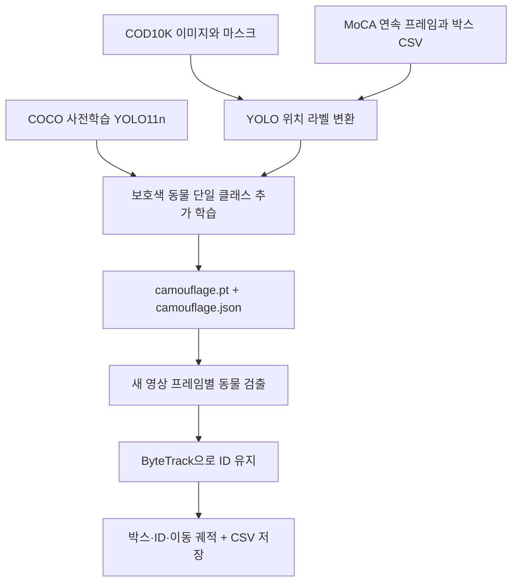

# 보호색 동물 검출·추적

담당: kumohyunho / Codex. 기존 YOLO·ByteTrack·GUI는 유지하고 `extensions/camouflage.py`에 연결합니다.
한글 기능이나 공통 추적기를 수정하지 않습니다.

## 처리 순서와 현재 상태



* **구현**: COD10K/MoCA 전처리, YOLO 추가 학습·val/test 평가·가중치 설치, GUI 확장, 단독 영상/카메라 실행,
  주석 프레임 전용 HOTA·IDF1·MOTA·IDSW 평가.
* **미실행**: 전체 COD10K/MoCA 다운로드, 실제 추가 학습, 실제 보호색 동물 영상의 정확도/FPS, 실제 카메라 검증.
  현재 저장소에는 학습된 `models/camouflage.pt`가 없습니다. 모델·설정이 없으면 GUI는 이유를 표시하고 비활성화합니다.
* 테스트의 가짜 검출기·합성 픽스처는 코드 검증용입니다. 여기서 얻은 점수를 실제 동물 성능으로 보고하지 않습니다.

## 1. 데이터 받기

원본은 `datasets/raw/`, 전처리 결과는 `datasets/camouflage/`에 둡니다. 둘 다 git에 커밋하지 않습니다.

* [COD10K 공식 소개·다운로드](https://dengpingfan.github.io/pages/COD.html): 정지 이미지와 객체/인스턴스 마스크.
* [MoCA 공식 다운로드](https://www.robots.ox.ac.uk/~vgg/data/MoCA/): 연속 영상 프레임과 박스·동작 주석.
* [MoCA 박스 CSV를 사용하는 저자 연구 코드](https://github.com/charigyang/motiongrouping):
  `annotations.csv`의 `file_list,spatial_coordinates` 형식을 지원합니다. 해당 연구의 전처리·프레임 번호·보간 여부를 확인해야 합니다.
  CSV만 별도 영상에 붙이지 말고 **그 CSV와 정확히 대응하는 해상도·번호의 프레임**을 사용하세요.

이 코드는 데이터 이용 조건을 확인하고 내려받은 로컬 데이터만 처리하며 대용량 파일을 자동 다운로드하지 않습니다.
원본 MoCA ZIP의 VIA 프로젝트/CSV와 연구용 파생 CSV는 형식이 다를 수 있습니다.
아래 두 CSV 형식 외에는 오류를 내므로 원본 주석을 아래 정규화 형식으로 변환·검토해야 합니다.

```text
datasets/raw/
  COD10K-v3/
    Train/Image/COD10K-CAM-....jpg
    Train/GT_Object/COD10K-CAM-....png
    Test/Image/COD10K-CAM-....jpg
    Test/GT_Object/COD10K-CAM-....png
  MoCA/
    frames/
      crab/00000.jpg, 00001.jpg, ...
      fox/00000.jpg, 00001.jpg, ...
      moth/00000.jpg, 00001.jpg, ...
    boxes.csv
```

COD10K는 `CAM`을 양성, `Background`를 빈 라벨의 음성 이미지로 사용하고 `NonCAM`은 제외합니다.
`Background`도 같은 크기의 빈 마스크가 있어야 하며, 누락 마스크를 음성으로 추정하지 않습니다.
기본 `GT_Object` 이진 마스크는 전경 전체를 감싸는 **박스 하나**로 바꿉니다.
여러 개체가 같은 마스크에 있으면 합쳐진 박스가 되므로, 다중 개체 검출 학습에는
실제 인스턴스 마스크를 확인하고 `--mask-folder GT_Instance --instance-masks`를 사용하세요.
인스턴스 모드에서는 0/검정 이외의 값·색이 각각 한 개체입니다. 경계선/그레이스케일 확률 마스크에 사용하면 안 됩니다.

## 2. MoCA 정답과 ID 확인

권장 정규화 CSV는 다음과 같습니다. `filename`은 원본 프레임 파일명이며, 좌표는 **0 기반 픽셀 xywh**입니다.

```csv
sequence,filename,x,y,width,height,track_id
crab,00000.jpg,100,80,90,60,1
crab,00005.jpg,108,82,90,60,1
fox,00000.jpg,250,140,120,85,1
```

* `track_id`는 영상 안에서 같은 개체에 같은 양의 정수를 부여합니다. 여러 개체는 같은 프레임에서 서로 다른 ID여야 합니다.
* ID가 없으면 해당 칸을 비워 둡니다. **검출 학습은 가능하지만, 추적용 `gt.txt`는 생성하지 않습니다.**
* 사용자가 모든 입력 영상에서 동일한 동물 한 마리만 등장함을 직접 확인했다면 `--single-object`로 ID 1을 부여할 수 있습니다.
  이 옵션은 자동 개체 식별이 아닙니다. 서로 다른 동물이 교대로 나오는 영상도 별도 ID 주석이 필요합니다.
* 미주석 프레임은 CSV에서 빼되, **프레임 이미지 자체는 모두 유지**합니다.
  주석 누락을 동물 없음으로 가정하지 않습니다. 실제로 동물이 없다고 확인한 프레임은 좌표 네 칸을 비운 행으로 기록합니다.
* `file_list=/crab/00000.jpg`, `spatial_coordinates=[2,x,y,width,height]`인 파생 CSV도 지원합니다.
  `metadata`의 동작 분류 번호를 개체 ID로 오인하지 않습니다. ID 열이 없으면 위와 같은 확인·보완이 필요합니다.
* 보간된 박스를 사람이 직접 단 정답으로 보고하지 마세요. 엄밀한 평가는 실제 주석 행만 포함한 CSV로 변환합니다.
* 프레임은 이름이 연속된 숫자여야 하며, 한 영상에서 해상도와 확장자가 같아야 합니다.
  FPS가 서로 다른 영상은 동일 FPS로 추출해 입력하거나 변환 작업을 따로 준비해야 합니다. 기본 24fps를 실제 값으로 확인하세요.

## 3. 전처리

프로젝트 폴더에서 실행합니다. `--moca-frames` 없이 COD10K만 먼저 준비할 수도 있습니다.

```bash
python camouflage_dataset.py --cod10k datasets/raw/COD10K-v3 --moca-frames datasets/raw/MoCA/frames --moca-csv datasets/raw/MoCA/boxes.csv --fps 24 --output datasets/camouflage
```

단일 개체를 직접 확인했고 CSV에 ID가 없다면 위 명령에 `--single-object`를 붙입니다.

* COD10K: 공식 Train의 약 90%/10%를 train/val로, 공식 Test를 test로 유지.
* MoCA: 최소 3개 영상을 준비하고 **영상 단위** 약 70%/15%/15% 분할. 작은 데이터에서도 각 분할에 최소 한 영상 확보.
* 같은 seed와 입력이면 같은 분할. 서로 다른 분할에 파일 내용이 동일한 이미지가 있으면 오류로 중단.
  재인코딩·유사 장면 중복까지 탐지하는 것은 아니므로 COD10K/MoCA의 원본 영상 출처 중복도 확인해야 합니다.
* 잘못된 박스·누락 마스크·크기 불일치·중복 ID·기존 출력 경로는 오류로 중단. 성공할 때만 최종 폴더로 이동.

```text
datasets/camouflage/
  dataset.yaml                      # camouflaged_animal 한 클래스
  splits.json                       # 출처·분할·영상·이미지 SHA256·개수
  images/{train,val,test}/...
  labels/{train,val,test}/...txt     # class cx cy width height, 0~1 정규화
  tracking/{train,val,test}/<영상>/
    img1/000001.jpg, ...             # 미주석 프레임도 모두 포함, 번호는 1부터
    seqinfo.ini
    annotations.json                # 평가할 프레임 목록, 원본 파일명, ID 확인 상태
    gt/gt.txt                       # ID 확인된 영상만 생성, MOT의 1 기반 xywh
```

## 4. YOLO 추가 학습

COCO 사전학습 `yolo11n.pt`를 시작점으로 사용하므로 COCO 전체를 다시 학습하지 않습니다.
학습 결과는 **동물 종 분류가 아닌 보호색 동물 한 클래스 검출기**입니다.

```bash
python train_camouflage.py --data datasets/camouflage/dataset.yaml --epochs 50 --imgsz 640 --batch 8 --device 0 --install
```

CPU에서는 `--device cpu`를 사용합니다. GPU Colab 절차는 [`colab/train_camouflage.ipynb`](../colab/train_camouflage.ipynb)를 참고하세요.
가장 좋은 val 가중치로 val/test mAP를 측정하고 `models/camouflage.pt` + `.json`을 설치합니다.
JSON에는 학습 옵션, 분할 개수, 데이터 명세 해시, 가중치 해시, 검출 mAP, 추적 시작 설정이 들어갑니다.
기존 `.pt` 또는 `.json`이 있으면 덮어쓰지 않습니다. 둘을 함께 백업하고 설치하세요.
`--install` 없이 학습했다면 `training_runs/camouflage*/weights/best.pt`와 `best.json`을 함께 복사해 이름을 바꿀 수 있습니다.

## 5. GUI와 새 영상 추적

```bash
python main.py
```

기본 검출 모델은 기존 `yolo11n.pt`/사람 모델로 두고, **확장 → 보호색 동물**을 켭니다.
`camouflage.pt`를 기본 사람·동물 검출 모델 칸에 선택하면 기존 클래스 선택과 맞지 않습니다.
영상 열기 → 시작 → `보1`, `보2`와 보호색 동물 라벨·이동 경로 확인 → 결과 저장.
기존 CSV 저장·불러오기, 결과 재생, 확장 설정 저장 기능을 그대로 사용하며, 결과의 `source`는 `camouflage`입니다.

GUI 없이 전용 검출기만 실행하고 결과 영상을 저장할 수도 있습니다.

```bash
python run_camouflage.py --video new_animal.mp4 --output results/camouflage/new_video --device cpu
python run_camouflage.py --camera 0 --frames 300 --output results/camouflage/camera
```

출력: `tracked.mp4`(CAM 번호·박스·궤적), `tracks.csv`, `tracks.json`(원본·FPS·설정·평균 검출+추적 시간).
기존 결과 폴더는 보존하며 다른 이름으로 실행해야 합니다. CLI 영상 글자는 OpenCV 호환 영문, GUI는 한국어입니다.

ByteTrack은 검출을 높은/낮은 점수로 나눠 2차 연결하고, 검출이 끊긴 트랙을 버퍼에 유지합니다.
기본 시작값: high=0.4, low=0.05, new=0.5, 유지=60프레임(30fps 기준, 실제 FPS에 맞춰 조정).
이 값은 **검증 데이터로 최적화한 결과가 아닙니다.** 기본은 색 히스토그램 재식별을 끈 위치 기반 추적입니다.
가림이 길어 버퍼를 넘으면 새 ID가 생길 수 있습니다. 실제 데이터 비교 후 외형·재연결 옵션을 켜야 합니다.
완전히 가려진 동물을 직접 관측한 것처럼 표시하지 않으며, 검출이 없는 프레임은 결과 박스·CSV에도 추가하지 않습니다.
다시 연결되면 기존 ID로 궤적을 잇습니다. 가림 구간의 경로는 관측되지 않았으며 거리는 화면 좌표(px) 기준입니다.

## 6. 추적 성능 평가

```bash
python evaluate_camouflage.py datasets/camouflage/tracking/val --output results/camouflage/val
python evaluate_camouflage.py datasets/camouflage/tracking/test --output results/camouflage/test
```

영상의 **모든 프레임을 추적**하고 `annotations.json`의 **주석 프레임에서만** HOTA·IDF1·MOTA·IDSW·Frag 등을 계산합니다.
정답 ID가 없는 영상은 오류로 중단합니다. 출력은 영상별 MOT 결과, 전체/영상별 `metrics.json`, ID 변경·단절 이벤트입니다.
희소 주석 사이에서 생겼다가 사라진 실패는 측정되지 않을 수 있으므로, 촘촘한 주석 평가와 같은 조건으로 비교하면 안 됩니다.
평가 파일의 class=1은 기존 MOT 지표 코드의 대상 표시로, 동물을 사람으로 학습한다는 뜻이 아닙니다.

다른 설정 비교: `--tracker-config configs/camouflage_candidate.json`으로 `TrackerConfig` 필드 JSON을 지정하고,
검증 영상에서만 임계값·유지 시간을 조정한 뒤 test에서 최종 평가하세요.
GUI에도 선택한 설정을 적용하려면 `models/camouflage.json`의 `tracker`에 같은 내용을 저장합니다.
현재 전용 결과는 기존 사람 모델용 `results/comparison.json`에 자동 병합하지 않습니다.

## 테스트

```bash
python -m unittest discover -s tests -t .
```

`tests/test_camouflage.py`는 마스크 변환·영상 분할·데이터 누수 차단·ID 검증·희소 평가·실제 ByteTrack의
저신뢰도 연결과 짧은 가림·CSV 복원·학습 호출/모델 설치·MP4 입출력을 가짜 검출기와 임시 파일로 확인합니다.
실제 보호색 동물 정확도, 성능 개선 수치, GUI 화면 검증은 별도이며 미실행입니다.
