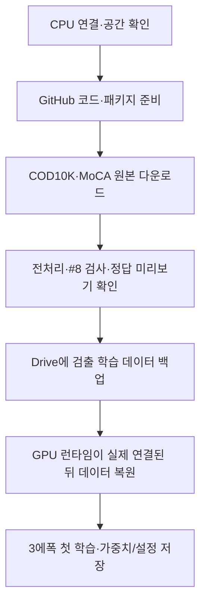

# Colab CPU 데이터 준비와 GPU 첫 학습

사용자가 확인한 CPU 런타임의 여유 디스크는 107.6GiB입니다. GPU 런타임 할당은 실패한 상태였습니다.
아래 준비는 GPU 없이 가능합니다. GPU 할당 성공 여부와 변경 후 저장 공간은 새 런타임에서 다시 확인해야 합니다.

[`colab/camouflage_colab_start.ipynb`](../colab/camouflage_colab_start.ipynb)를 Colab에서 열고 순서대로 실행하세요.



| 코드 | 역할 |
|---|---|
| `fetch_camouflage_data.py` | 출처·파일 해시를 기록하며 실제 공개 원본 확보. 기본 표본, `--full` 전체 준비 |
| `camouflage_dataset.py` (기존) | 단일 클래스 YOLO 라벨·학습/검증/테스트 분리 |
| `inspect_camouflage_data.py` (기존 #8) | 구조 검사·정답 미리보기 |
| `colab/camouflage_colab_start.ipynb` | CPU 준비와 GPU 학습 셀 분리·Drive 백업/복원 |
| `train_camouflage.py` (기존) | GPU 추가 학습·val/test 검출 평가·모델 설치 |
| `tests/test_fetch_camouflage_data.py` | 네트워크 없는 다운로드 동작·마스크·표본·실패 처리 검사 |

## 데이터와 실행 범위

COD10K는 [nobg 공개 미러](https://huggingface.co/datasets/nobg/COD10K)의 원본 이미지/PNG 마스크를 사용합니다.
미러의 revision을 고정해 기록합니다. `--full`은 **보호색 이미지 5,066쌍**이며 COD10K의 Background/NonCAM을 포함한 10,000장 전체가 아닙니다.
원본 배포 설명·이용 조건은 [COD10K 공식 페이지](https://dengpingfan.github.io/pages/COD.html)와 미러 카드를 확인하세요.

MoCA는 [Oxford 공식 ZIP](https://www.robots.ox.ac.uk/~vgg/data/MoCA/)을 사용합니다.
실제 ZIP의 `MoCA/Annotations/annotations.csv`를 확인해 주석 헤더와 수동 사각형을 정규화했습니다.
motion 속성은 개체 ID가 아닙니다. 없는 ID를 만들지 않으므로 #8은 ID 미확인 경고를 표시하고 추적 ID 평가는 할 수 없습니다.
프레임 이미지로 FPS를 확인할 수 없어 전처리의 24fps는 검출 학습용 임시값이며 이동 속도/FPS 분석에 사용하면 안 됩니다.

* `--full`: 권장 여유 공간 40GiB 이상을 확인하고 MoCA ZIP 전체 다운로드·JPEG 프레임 추출. 압축 파일은 추출 후 제거.
  COD10K 미러는 모든 row group을 읽습니다. 전체 모드는 이 작업 환경에서 미실행입니다.
* 기본 표본: COD10K Train 256/Test 64쌍, MoCA chameleon/crab/arctic_fox 영상당 최대 30프레임.
  각 Parquet shard의 첫 row group에서 파일명+seed 해시 순으로 고르므로 전체 대표 표본이 아닙니다.
* 짧은 영상은 ZIP에 실제로 존재하는 프레임만 사용합니다. 원본의 주석이 있는 해당 프레임만 변환합니다.
* 다운로드가 실패하면 완성되지 않은 폴더를 최종 경로로 게시하지 않습니다. 실패한 다운로드는 다시 실행해야 하며 재개 기능은 없습니다.
* 기존 원본 폴더는 덮어쓰지 않습니다. 데이터·생성 영상·마스크는 git에 커밋하지 않습니다.
* 다른 원본 영상·재인코딩 이미지의 중복은 해시만으로 증명할 수 없습니다. 실제 정답과 출처의 시각 검토가 필요합니다.

## CPU에서 할 일

노트북 **①~⑤만** 순서대로 실행합니다. ③ 전체 다운로드는 인터넷 속도에 따라 오래 걸립니다.
④ 구조 오류가 있으면 중단하고 오류를 먼저 해결합니다. 전체 원본에서 추가 오류가 발견될 가능성을 숨기거나 자동 무시하지 않습니다.
⑤는 검출 학습용 images/labels·설정·명세만 Drive에 백업합니다. **전체 MoCA 추적 시퀀스는 백업하지 않습니다.**
Drive 여유 용량은 Drive의 저장용량 화면에서 별도로 확인하세요. `/content` 107.6GiB와 Drive 용량은 별개입니다.

## GPU가 연결되면 할 일

런타임 유형을 GPU로 바꾸고 연결이 완료된 뒤 `nvidia-smi` 또는 `torch.cuda.is_available()`로 실제 연결을 확인합니다.
런타임이 바뀌었다면 노트북 ①·②를 다시 실행하고 **⑥ 복원 → ⑦ 학습**을 진행합니다.
GPU가 없으면 학습 셀이 중단되며 CPU 학습으로 조용히 전환하지 않습니다.

3에폭은 첫 실행 점검이며 충분한 성능을 보장하지 않습니다. 메모리 부족 시 batch 8 → 4 → 2로 낮추세요.
학습 체크포인트를 Drive에 기록하고 완료 후 camouflage.pt/json도 함께 보관합니다.
전체 시간·GPU 가용성·모델 성능은 실제 실행 전 확정하지 않습니다.

## 검증 범위

부분 다운로드 서버 응답·길이, 원본 무손실 마스크, ID 미생성, 짧은 영상, 공간 부족 차단, 실패 시 원본 보존을 테스트합니다.
전체 Colab 실행·Drive 인증·백업 복원·GPU 학습은 사용자 런타임에서 검증해야 하며 이 환경에서는 미실행입니다.
학습 가중치는 아직 생성하지 않았습니다. 합성 테스트나 코드 존재를 실제 학습 완료로 표현하지 않습니다.

이번 환경에서 실제 표본 확보·전처리·검사까지 실행했습니다: COD10K 320쌍(Train 256/Test 64), MoCA 3개 영상 90프레임.
주석이 있는 MoCA 18프레임을 더해 검출 데이터는 train 237/val 31/test 70장이며 #8 검사 결과 오류 0·ID 미확인 경고 3개입니다.
전체 테스트 84개와 변경 코드의 미사용 import·변수 검사를 통과했습니다. 전체 다운로드·Colab 인증·GPU 학습은 미실행입니다.

## ④에서 Train/Test 중복으로 중단될 때

사용자의 전체 데이터 실행에서 `COD10K-CAM-1-Aquatic-3-Crab-32.jpg`가 Train과 Test에 동일 바이트로 존재한다는
오류가 보고되었습니다. 기존 검사기는 누수를 막기 위해 중단한 것입니다. 재다운로드나 원본 삭제가 필요한 오류가 아닙니다.

`feature/camouflage-dedup-fix` 브랜치는 명시적인 `--cod10k-duplicates prefer-test` 옵션을 추가합니다.

* 공식 Test 이미지를 보존하고 같은 해시의 Train 사본은 **생성할 학습 데이터에서만 제외**합니다.
* 남은 Train 이미지는 SHA256 그룹 단위로 train/val을 나눠 같은 이미지가 두 분할에 걸리지 않게 합니다.
* 제외 목록·해시·보존 Test 파일명은 생성된 `splits.json`의 `cod10k_duplicates`에 기록합니다.
* 원본 이미지·마스크는 삭제하지 않습니다. 기존 출력 폴더도 덮어쓰지 않습니다.
* 기본 `error` 정책과 최종 누수 검사는 유지됩니다. Colab 노트북 ④는 prefer-test를 명시하고 실제 오류 로그를 출력합니다.
* 같은 분할 내부의 반복 이미지는 보존하며 보고서에 기록합니다. 재인코딩·유사 이미지 중복까지 없앴다는 뜻은 아닙니다.
  이 정책으로 train/val 구성과 개수가 달라지므로 이전 실험 및 공식 벤치마크와 같은 조건이라고 보고하면 안 됩니다.

이미 다운로드한 Colab에서는 코드 브랜치만 업데이트하고 기존 RAW 경로로 아래 전처리를 실행합니다.

```bash
python camouflage_dataset.py --cod10k datasets/raw/camouflage-colab/COD10K-v3 --moca-frames datasets/raw/camouflage-colab/MoCA/frames --moca-csv datasets/raw/camouflage-colab/MoCA/boxes.csv --fps 24 --cod10k-duplicates prefer-test --output datasets/camouflage
```

성공한 뒤 기존 노트북 ④를 다시 실행하면 `splits.json`이 있어 전처리를 건너뛰고 #8 검사와 미리보기를 진행합니다.
기존 출력 폴더 충돌이 따로 발생하면 삭제하지 말고 내용을 확인하거나 새 DATA/REVIEW 경로를 지정하세요.

수정 검증: 기존 중복 중단, Test 우선 보존, 원본 바이트 보존, Train 해시 그룹 분리와 재현성,
데이터 부족 시 중단, Test 내부 반복 보존을 포함한 전체 테스트 89개 통과.
로컬 실제 표본에도 새 정책을 적용해 #8 검사 오류 0·ID 미확인 경고 3개를 확인했습니다.
사용자의 전체 Colab 데이터에서 실제 제외되는 수와 남은 오류는 실행 출력·명세로 확인해야 하며 여기서 추정하지 않습니다.
