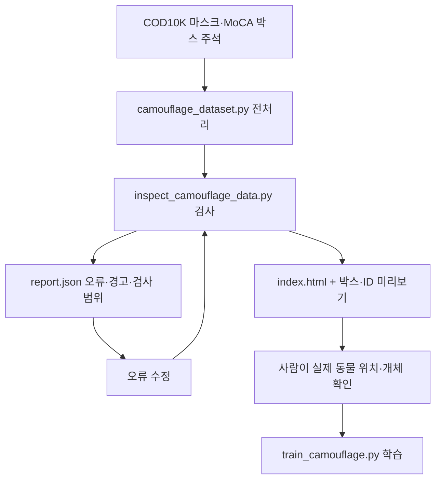

# 보호색 데이터 확인 — 학습 전 검사

이 단계는 `feature/camouflage`의 전처리 결과를 받아 **학습 전에 구조 오류를 찾고, 사람이 정답을 확인할 자료**를 만듭니다.
새 브랜치 `feature/camouflage-data-check`는 기존 보호색 코드를 포함합니다. 기존 브랜치를 변경하지 않습니다.

## 순서와 코드 역할



| 코드 | 역할 | 모델 필요 여부 |
|---|---|---|
| `camouflage_dataset.py` (기존) | 원본을 학습·평가용 데이터로 변환 | 필요 없음 |
| `inspect_camouflage_data.py` (추가) | 변환 결과의 파일·좌표·프레임·ID 형식 검사, 정답 미리보기 | 필요 없음 |
| `tests/test_inspect_camouflage_data.py` (추가) | 정상/잘못된 임시 데이터로 오류 검출 및 입력 보존 검증 | 필요 없음 |
| `train_camouflage.py` (기존) | 확인한 데이터로 YOLO 추가 학습 | 사전학습 YOLO 필요 |

새 검사기는 Pillow로 이미지를 읽고 PyYAML로 설정을 읽습니다. PyYAML은 Ultralytics의 기존 의존성이지만
직접 사용하는 패키지이므로 `requirements.txt`에 `PyYAML>=6.0,<7`을 명시했습니다. GUI·공통 추적기는 변경하지 않습니다.

## 실행

프로젝트 폴더에서 기존 전처리 명령을 실행한 다음:

```bash
python inspect_camouflage_data.py datasets/camouflage --check-hashes --samples 12 --output results/camouflage/data-check
```

* `--check-hashes`: 실제 검출 이미지와 **미주석 프레임을 포함한 추적 이미지**의 SHA256을 재계산합니다.
  생략하면 검출 이미지의 명세 해시만 비교하므로 현재 파일 내용의 변조·추적 프레임 중복까지 검사하지 않습니다.
* `--samples`: 미리보기 개수. 분할·출처·영상 그룹을 번갈아 선택합니다. 0이면 JSON/HTML만 생성합니다.
* 데이터 폴더 내부나 이미 있는 경로에는 쓰지 않습니다. 재검사는 `--output`에 새 경로를 지정하세요.
* 원본 이미지·라벨·설정은 수정하거나 삭제하지 않습니다. 자동 수정·자동 정답 생성 기능은 없습니다.

```text
results/camouflage/data-check/
  report.json          # 검사한 레코드·영상, 오류·경고, 해시 검사 여부와 한계
  index.html           # 브라우저에서 열어 확인, 외부 서버/인터넷 불필요
  preview_000.png ...  # 입력 정답 박스와 선언된 추적 ID를 표시한 표본
```

HTML의 녹색 사각형은 YOLO **정답 라벨**, 청록색 글자는 MOT 정답에 **기록된 ID**입니다.
모델이 검출한 결과나 올바른 개체 ID임을 인증한 표시가 아닙니다. 전체 영상을 보고 사람이 확인해야 합니다.

## 검사하는 내용

| 검사 | 발견할 수 있는 문제 |
|---|---|
| 명세·YAML·분할 개수 | 다른 클래스 설정, 잘못된 학습 경로, 누락/손상된 JSON·YAML, 개수 불일치 |
| 이미지·YOLO 라벨 | 읽을 수 없는 이미지, 누락 라벨, NaN/무한대, 0 크기, 화면 밖 박스, 다른 클래스 |
| 데이터 분리 | 같은 MoCA 영상 이름의 분할 중복, 분할 사이 동일 이미지 해시 |
| 시퀀스 | seqinfo와 명세의 불일치, 누락 프레임, 해상도·FPS·평가 프레임 목록 오류 |
| MOT ID·박스 | 같은 프레임의 중복 ID, 잘못된 번호·경계·가시 비율, YOLO 박스와 불일치 |
| 검출/추적 연결 | 미주석 프레임의 검출 학습 포함, 검출 이미지와 대응 추적 프레임 내용의 불일치 |
| 등록되지 않은 파일 | images/labels/img1 안의 명세에 없는 파일을 경고로 표시. 삭제하지 않음 |

구조 오류가 있으면 CLI 종료코드 1, 구조 오류가 없으면 0입니다. ID 미확인 등 경고만 있을 때도 0이며,
**0이 곧 학습·추적 평가 준비 완료를 보장하지는 않습니다.** 명령 자체의 인수 오류·출력 경로 충돌은 별도 오류입니다.
데이터 오류로 보고서 생성이 가능한 경우에는 오류 목록과 읽을 수 있는 표본을 남깁니다.

## 사실 확인과 검증의 한계

* 자동 확인 가능한 것은 **구조와 수치의 일관성**입니다. 실제 보호색 여부·동물 종·개체 ID의 의미·정답 누락 여부는 자동 판단하지 않습니다.
* 같은 원본 영상의 서로 다른 프레임이나 재인코딩된 중복 이미지는 해시가 달라 누수를 놓칠 수 있습니다.
* 이 검사기는 전처리한 파일끼리 비교합니다. 원본 MoCA ZIP의 모든 주석 형식을 검증하거나 원본과의 변환 정확성을 증명하지 않습니다.
* 미리보기는 표본입니다. 동물 전체·가림·교차·퇴장 후 재등장 장면은 원본 영상을 별도로 확인해야 합니다.
* 이 단계의 테스트는 임시 합성 픽스처로 실행합니다. 실제 COD10K/MoCA 검사·모델 학습·실영상 정확도와 FPS 측정은 미실행입니다.
* ‘환각이 전혀 없다’거나 ‘보호색 동물 검출에 성공했다’는 판정은 하지 않습니다. 실행한 테스트와 코드가 보장하는 범위만 보고합니다.

## 불필요한 코드·파일 점검

실행 코드 1개·테스트 1개·안내 문서 1개를 추가하고, 기존 보호색 안내에는 사용 명령만 연결합니다.
기존 전처리·학습·추적 코드는 복제하지 않습니다. 테스트 자료와 검사 산출물은 임시/작업 폴더에 만들고 커밋하지 않습니다.
기존 다른 담당 파일은 삭제·수정하지 않습니다. 등록되지 않은 데이터 파일도 용도를 알 수 없으므로 경고만 남깁니다.

검증 명령:

```bash
python -m unittest discover -s tests -t .
```

이번 변경의 확인 결과:

* 기존 테스트 포함 **64개 통과**, 그중 새 검사기 테스트 **15개**. 실행 환경의 수치 연산 스레드 경합을 줄이기 위해
  `OPENBLAS_NUM_THREADS=1 OMP_NUM_THREADS=1`을 지정했습니다. 첫 전체 실행은 지연으로 중단하고 같은 테스트를 이 설정으로 다시 실행했습니다.
* 새 코드·테스트에 `ruff check --select F,E9` 실행: 미사용 import·변수 및 해당 문법 오류 없음.
* 전체 저장소의 같은 검사에서는 기존 `main.py`의 미사용 `STATUS_EXITED`, `STATUS_OCCLUDED` import 2개 발견.
  공통 GUI 파일은 이번 작업 범위에서 수정하지 않았습니다. 이 결과는 모든 종류의 불필요한 코드를 탐지했다는 의미는 아닙니다.
* 임시 MoCA 형식 픽스처로 오류 0·경고 0 보고서와 미리보기 3장 생성. 한 미리보기에서 박스와 ID 7 표시를 직접 확인했습니다.
* 테스트 데이터·보고서·미리보기·검사 로그는 작업/임시 경로에 보관하고 커밋하지 않습니다.
* 실제 COD10K/MoCA 폴더가 없음을 확인했으며 실제 데이터 검증·학습·성능 수치는 보고하지 않습니다.
