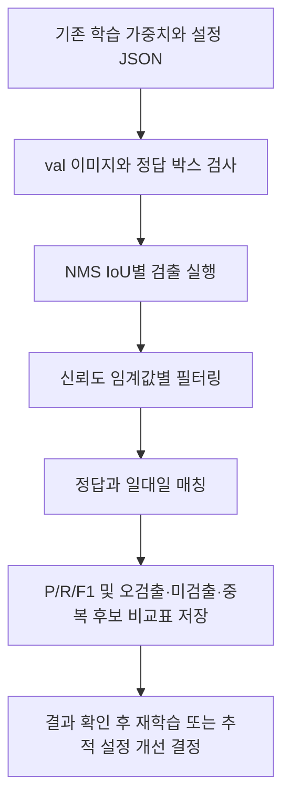

# 첫 학습 이후 검출 설정 비교

3에폭 학습과 영상 출력 다음에는 검증 분할의 정답 박스와 검출 결과를 비교합니다.
한 동물에 두 ID가 보이는 화면만으로 학습 실패나 추적기 오류를 확정할 수 없습니다.
이 코드는 **YOLO 검출 단계**를 비교하며 ByteTrack 자체의 중복 ID 원인은 별도 확인해야 합니다.



| 파일 | 역할 |
|---|---|
| `compare_camouflage_detection.py` | val 전체에서 검출 설정을 비교하고 CSV·JSON 저장 |
| `tests/test_compare_camouflage_detection.py` | 두 실제 객체·중복 검출·미검출·분할 제한·실패 시 결과 보존 검사 |
| 이 문서 | 사용자 Colab에서 학습된 실제 모델로 실행하는 방법 |

## Colab 실행

데이터 준비·학습을 다시 실행하지 않습니다. 기존 가중치와 검증 데이터가 있는 런타임에서 실행합니다.
런타임이 초기화됐다면 기존 노트북 ①·②·⑥으로 환경·검출 데이터를 먼저 복원하세요.
가중치는 Drive에 연결되어 있어야 합니다. 새 코드만 아래처럼 가져옵니다.

```python
import subprocess, sys, json
from pathlib import Path
from uuid import uuid4

PROJECT = Path('/content/AI_Project_Level_3-main')
subprocess.run(['git', 'fetch', 'origin'], cwd=PROJECT, check=True)
subprocess.run(['git', 'switch', 'feature/camouflage-detection-check'], cwd=PROJECT, check=True)

import torch
assert torch.cuda.is_available(), 'GPU 연결을 확인하세요.'
WEIGHTS = Path('/content/drive/MyDrive/camouflage_learning/models/camouflage.pt')
OUTPUT = Path('/content/drive/MyDrive/camouflage_learning/detection_checks') / uuid4().hex[:8]
subprocess.run([
    sys.executable, 'compare_camouflage_detection.py',
    '--data', str(PROJECT/'datasets/camouflage'),
    '--weights', str(WEIGHTS), '--device', '0', '--output', str(OUTPUT)
], cwd=PROJECT, check=True)
report = json.loads((OUTPUT/'summary.json').read_text())
print('검출 기준 최고 F1 후보:', report['best'])
print('전체 비교표:', OUTPUT/'comparison.csv')
```

50장마다 진행 상황을 출력합니다. 기본값은 신뢰도 5개 × NMS IoU 3개입니다.
각 이미지에 NMS IoU별로 1회씩 추론하고 신뢰도별 결과를 재사용하므로 val 이미지 수의 3배만큼 추론합니다.
메모리에는 한 이미지의 예측만 유지합니다. 실행 시간은 GPU·이미지 해상도·Drive I/O에 따라 달라집니다.

## 지표 해석

* TP: 신뢰도 내림차순으로 정답과 IoU 0.5 이상 일대일 매칭한 검출 수.
* FP: 남는 검출 수. FN: 매칭하지 못한 정답 수.
* Precision = TP/(TP+FP), Recall = TP/(TP+FN), F1 = 두 값의 조화 평균. 저장 범위는 0~1입니다.
* `duplicate_candidates`: 매칭에 실패했지만 어떤 정답과 IoU 0.5 이상인 검출 수. FP의 부분집합이며 실제 중복 확정값은 아닙니다.
  촘촘한 실제 다중 객체나 불완전한 정답도 영향을 줍니다.
* `capped_images`: 낮은 신뢰도로 검출한 박스가 max_det=300에 도달한 이미지 수.
  0보다 크면 박스 수 제한의 영향을 검토해야 합니다.

NMS IoU가 낮으면 겹치는 검출을 더 강하게 제거하여 실제 가까운 두 동물도 놓칠 수 있습니다.
신뢰도를 높여 중복이 줄어도 미검출이 늘 수 있으므로 Recall과 함께 봅니다.
모든 후보는 동일 가중치·동일 val 이미지로 비교하며 test는 읽지 않습니다.
선택 기준은 전체 객체를 합산한 검출 F1, 동률이면 지정된 후보 순서입니다.
일대일 매칭 방식과 고정 임계값 때문에 Ultralytics의 mAP·best-F1 P/R과는 다른 지표입니다.

**최고 후보를 모델이나 추적기에 자동 적용하지 않습니다.** ByteTrack은 낮은 신뢰도 박스도 기존 ID 연결에 사용하므로
여기서 고른 검출 신뢰도를 그대로 `low_thresh`에 적용하면 추적이 끊길 수 있습니다.
설정을 실제 추적 경로에 연결하는 작업과 전후 영상 비교는 다음 단계입니다.
정답 ID를 검증하기 전까지 HOTA·IDF1·MOTA·ID Switches 기반 튜닝은 미실행으로 남습니다.

가중치·데이터 명세 SHA256을 보고서에 기록합니다. 기존 출력과 가중치는 덮어쓰지 않습니다.
새 의존성·데이터 사본·학습 가중치는 추가하지 않습니다.
자동 테스트는 합성 정답과 가짜 검출기를 사용하므로 실제 동물 검출 성능의 증거가 아닙니다.
사용자의 Colab에 있는 학습 모델로 실행하기 전에는 개선 여부와 수치를 알 수 없습니다.
