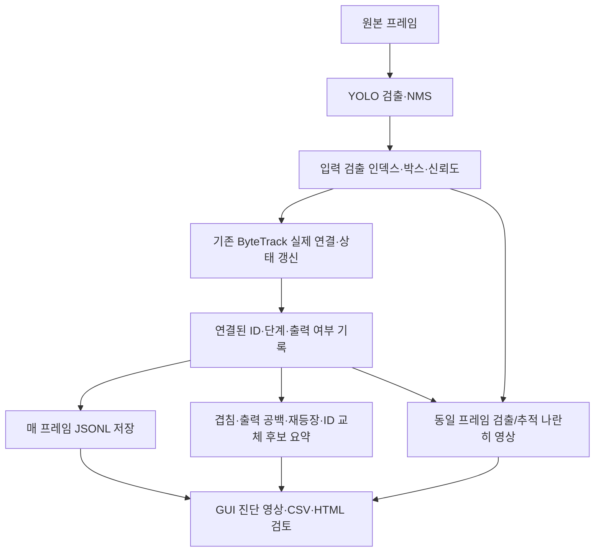

# 보호색 검출·추적 진단 기록

이 기능은 추적을 개선하거나 재학습하지 않고, 문제 원인을 검토할 근거를 저장합니다.
검출과 ID를 출력 좌표의 IoU로 다시 추정하지 않고 ByteTrack이 실제로 연결한 인덱스·ID·단계를 기록합니다.
공통 tracker/ 변경은 별도 PR로 분리하고 보호색 저장·화면 연결은 그 위의 새 브랜치에 추가합니다.



| 파일 | 역할 |
|---|---|
| `tracker/byte_tracker.py` | 선택적 diagnostics dict에 실제 연결·상태 기록. 할당·추적 알고리즘은 유지 |
| `camouflage_diagnostics.py` | 프레임 스트림·검토 후보·보고서·진단 영상 패널 생성 |
| `extensions/camouflage.py` | 진단을 켠 경우에만 기존 process 경로에 관찰·저장을 연결 |
| `run_camouflage.py` | `--diagnostics` 실행 옵션, 입력 해시·실효 설정·진단 영상 저장 |
| `camouflage_tracking_page.py` | 기본 체크된 진단 저장 옵션·완료된 진단의 재생/요약 버튼 |
| 새 테스트 2개와 기존 페이지 테스트 | 실제 연결·결과 불변성·기록·중지·실패·화면 연결 검사 |

## GUI에서 실행

1. 최종 `feature/camouflage-diagnostics` 브랜치의 `main.py`를 실행합니다.
2. **보호색 추적** 탭에서 모델·원본 영상을 선택합니다. 학습 데이터는 진단 실행에 필요하지 않습니다.
3. **진단 기록 저장** 체크를 유지하고 **보호색 추적 실행**을 누릅니다.
4. 완료되면 **진단 영상 재생**과 **진단 요약 열기**로 확인합니다.

기존 tracked.mp4·tracks.csv만 재생해서는 당시 검출과 실제 연결 단계를 복원할 수 없습니다.
박스가 그려지지 않은 원본 영상을 새로 처리해야 진단 파일이 생성됩니다.

일반 실시간 추적 탭은 자동 기록하지 않습니다. 보호색 전용 탭의 실행 경로에 연결되어 있습니다.
실행 중 버튼을 잠그고 중지된 부분 결과를 완료된 진단으로 표시하지 않습니다.
NMS는 선택한 모델 옆 실행 설정을 따르며, 진단 때문에 0.3으로 바꾸거나 학습률을 변경하지 않습니다.
새 clone에는 로컬에서 만든 `camouflage.inference.json`이 포함되지 않을 수 있으므로 화면의 실제 NMS 값을 확인하세요.
기존 Git 폴더에서 브랜치를 전환하면 미추적 로컬 설정 파일은 보통 유지되며 강제 덮어쓰기는 하지 않습니다.

터미널에서 실행하려면:

```powershell
python run_camouflage.py --video cuttlefish_test.mp4 --weights models/camouflage.pt --diagnostics --output runs/camouflage/diagnostic_01
```

`python`은 GUI가 정상 동작하는 가상환경을 사용합니다. 출력 폴더가 이미 있으면 다른 이름을 지정합니다.
CLI는 옵션을 생략하면 기존처럼 진단을 저장하지 않습니다. 모델·학습 JSON·실행 설정·정답 파일을 바꾸지 않습니다.

## 생성 파일

기존 tracked.mp4·tracks.csv·tracks.json과 같은 폴더에 다음을 저장합니다.

| 파일 | 확인할 내용 |
|---|---|
| `diagnostic.mp4` | 왼쪽: NMS 이후 검출 D번호·점수·high/low·실제 연결 ID/단계. 오른쪽: 출력 ID·점수·궤적. 상단 프레임 번호로 대응 |
| `diagnostic_frames.jsonl` | 매 프레임 한 줄. 검출·실제 연결·미연결 인덱스·tracked/lost/removed·실제 출력. 빈 프레임도 기록 |
| `diagnostic_events.csv` | 검토 후보 전체의 프레임·입력 FPS 기반 시간·유형·상세 |
| `diagnostic_summary.json` | 상태·실제 기록 수·유형별 건수·연결 단계 합계·규칙·입력 해시와 설정 |
| `diagnostic_report.html` | 사람이 읽는 요약. 유형별 최대 20건의 예시, 전체 CSV/JSONL 링크, 실행 설정 |

검출 인덱스 D0 등은 프레임 안에서만 유효합니다. ID는 트랙 식별자이며 뒤 소수점은 검출 신뢰도입니다.
진단 영상은 좌우로 합치므로 원본의 2배 너비입니다. GUI 재생기로 열며 브라우저의 MP4 코덱 지원은 별개입니다.

## 이벤트 해석

| 유형 | 해석 |
|---|---|
| 검출·트랙 겹침 | 같은 클래스의 박스 IoU 0.5 이상. 실제 두 동물의 겹침일 수 있어 중복 확정값이 아님 |
| 검출 없음 | 검출기가 NMS 이후 박스를 반환하지 않음. 동물의 실제 존재 여부는 알 수 없음 |
| 검출 있으나 출력 없음 | 낮은 점수·면적 제한·새 트랙 확인 대기 등이 가능. 추적 실패로 단정하지 않음 |
| 출력 공백 시작 | 이전 프레임 출력 ID가 현재 출력에 없음. 가림·이탈·검출 변화 등 확인 필요 |
| 같은 ID 재연결 | 추적기가 Lost ID를 다시 연결하거나 갤러리에서 재진입시킨 실제 기록 |
| ID 교체 후보 | 최근 30프레임 안에 출력된 뒤 사라진 ID와 같은 클래스·IoU 0.5 이상인 새 ID. 확인 대기 중 생성도 포함하며 visible 값으로 구분 |
| 트랙 제거 | 해당 프레임에 추적기가 제거 상태로 바꾼 트랙. 갤러리에 저장돼 나중에 재진입할 수도 있음 |

ID 교체 후보는 단순한 위치·시간 규칙이며 실제 ID Switches가 아닙니다.
겹침은 프레임·박스 쌍 단위로 관측하므로 같은 겹침이 여러 프레임 이어지면 반복 집계됩니다.
관측 건수를 실제 동물 수나 독립적인 추적 실패 횟수로 해석하지 마세요.
NMS **전** 박스나 실제 동물 수·정답은 복원하지 않습니다. 검토 후보가 0개여도 정확도가 보장되지 않습니다.
시간은 입력 FPS로 계산합니다. MoCA 프레임을 임시 FPS로 영상화했다면 실제 촬영 시간·물리 속도로 해석하지 않습니다.

## 기록·성능·중단

프레임과 사건을 파일에 순차 기록하며, 전체 영상 기록을 추가로 메모리에 모으지 않습니다.
최근 위치는 30프레임, HTML 예시는 유형별 20건으로 제한합니다. 모든 사건은 CSV에 남습니다.
25프레임마다 진행 상태를 갱신하고, 완료·실패 상태를 명시합니다.
강제 종료 시 running 상태와 부분 기록이 남을 수 있으며 이를 전체 완료로 해석하면 안 됩니다.
파일 덮어쓰기를 거부하고 기존 결과를 보존합니다.

추론 결과를 재사용하므로 진단 때문에 YOLO를 다시 실행하지 않습니다.
하지만 파일 저장·후보 계산·2배 너비 영상 인코딩 비용과 디스크 사용량은 추가됩니다.
reported processing_ms/fps에는 진단 분석·프레임 기록이 포함되고 영상 그리기·인코딩은 제외됩니다.
진단을 끈 실행의 속도와 그대로 비교해 추적기 속도 개선이라고 주장하면 안 됩니다.

## 사실 확인·검증 범위

정답 ID 기반 HOTA·IDF1·MOTA·IDSW 및 실제 동물 정확도 평가는 미실행입니다.
검출 좌표만으로 실제 연결을 추측하지 않고, 영상에 실제 동물이 있는지도 자동 단정하지 않습니다.
공통 추적기는 진단 유무의 ID·박스·공분산·lost 상태 동일성을 검사했습니다.
가짜 검출기로 추가 추론 없음·CSV 동일성·빈 프레임·확인 대기·재연결·제거·실패 기록을 검사합니다.
오프스크린 Qt에서 진단 옵션·버튼·영상 경로·완료/중지 연결을 검사합니다.
사용자 제공 모델과 기존 MoCA 표본 8프레임으로 실제 GUI 추적·진단 파일·좌우 영상 프레임 수신도 확인했습니다.
이 기능 연결 검사는 Windows 최종 실행이나 동물 정확도 측정을 대신하지 않습니다.
생성 데이터·모델·영상은 커밋하지 않으며 새 패키지도 추가하지 않습니다.
전체 unittest 130개가 통과했습니다. 새·변경 보호색 Python 코드의 Ruff F/E9 및 diff 공백 검사도 통과했습니다.
진단 활성/비활성의 추적 CSV가 같고 진단 활성화로 검출 호출이 늘지 않는지도 테스트했습니다.
