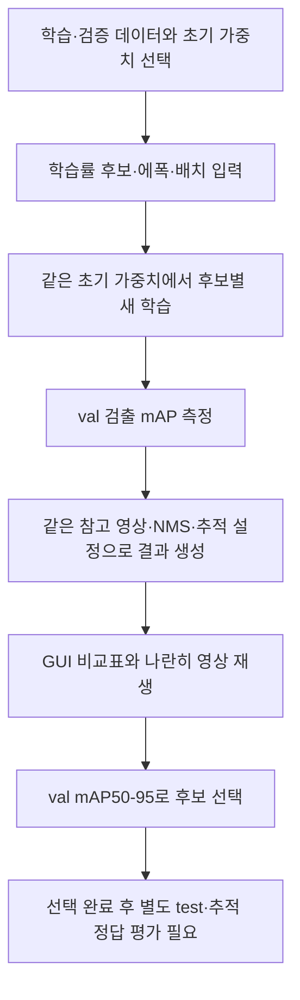

# GUI 학습률 변경·재학습·동일 영상 비교

학습률은 재생 중 검출 결과에 즉시 적용하는 값이 아닙니다. YOLO 가중치를 다시 학습하는 설정입니다.
이 기능은 후보별로 새 모델을 만들고 검증 데이터의 mAP와 같은 참고 영상의 추적 결과를 비교합니다.
일반 영상만 올려서는 정답 라벨을 대신할 수 없습니다. ByteTrack 자체를 학습시키는 기능도 아닙니다.



| 코드 | 역할 |
|---|---|
| `train_camouflage.py` | `--lr0`, `--patience`, `--val-only` 추가. 기존 기본 학습률 0.0005와 val/test 평가 동작 유지 |
| `compare_camouflage_learning_rates.py` | 데이터·누수 검사, 후보별 동일 조건 학습, 모델 쌍·영상·CSV/JSON 저장 |
| `camouflage_learning_gui.py` | 입력·로그·중지·기존 결과 불러오기·두 영상 재생 창 |
| 새 테스트 파일 2개 | 후보 독립성·val만 평가·원본 보존·GUI 비동기 실행/중지 검사 |

## PC에서 사용

이 기능의 전용 비교 창은 다음으로 단독 실행할 수 있습니다.

```powershell
C:\AI\camouflage-venv\Scripts\python.exe camouflage_learning_gui.py
```

메인 GUI의 버튼 연결은 공통 파일 변경을 분리하라는 저장소 규칙에 따라 별도 PR로 제공합니다.

| 입력 | 선택할 내용 |
|---|---|
| 데이터 | `datasets/camouflage/dataset.yaml`과 같은 위치의 `splits.json`, 실제 train/val 이미지·라벨 필요 |
| 초기 가중치 | 기본 `yolo11n.pt`. 현재 모델에서 추가 학습하려면 `models/camouflage.pt` 선택 가능. 모든 후보에 동일하게 사용 |
| 참고 영상 | 박스가 그려지지 않은 원본 영상. test 영상을 보고 설정을 반복 선택하지 않도록 별도 시연 영상 또는 검증 영상 권장 |
| 학습률 | 예: `0.0001, 0.0005`. 서로 다른 2~6개 |
| 에폭·배치·입력 크기 | 모든 후보에 동일 적용. 기본 3·8·640은 첫 비교 실행용이며 충분한 학습을 보장하지 않음 |
| 실행 장치 | CPU 또는 CUDA GPU 0. PC 실행은 PC 자원을 쓰며 Colab GPU를 원격으로 사용하지 않음 |
| 결과 상위 폴더 | 실행마다 별도 `lr_compare_<식별자>`를 생성. 기존 모델·결과는 덮어쓰지 않음 |

**재학습에는 학습 데이터가 필요합니다.** #13에서 만든 val 전용 압축만으로는 안 됩니다.
CPU에서 오래 걸리는 경우 중지하고 같은 CLI를 Colab GPU에서 실행한 뒤 결과를 PC GUI로 가져올 수 있습니다.
기존 3.3GB 검출 백업을 PC에 풀면 train/val 데이터 준비에 쓸 수 있습니다.
백업 YAML에 남은 Colab 절대 경로는 원본을 수정하지 않고 실행용 YAML에서 현재 데이터 위치로 바꿉니다.
원본 `.pt`, 학습 `.json`, 기존 `camouflage.inference.json`은 변경하지 않습니다.

## 비교 조건·결과

* 모든 후보가 같은 초기 `.pt`에서 시작합니다. 이전 후보 결과를 다음 후보의 초기값으로 사용하지 않습니다.
* AdamW, 시드 42, 나머지 조건을 고정하고 초기 학습률 `lr0`만 바꿉니다. 학습 중 스케줄·워밍업은 YOLO의 동일 설정을 사용합니다.
* 조기 종료 patience=0으로 지정한 에폭을 비교합니다. 모델은 각 후보의 val 기준 best.pt를 사용합니다.
* test 지표는 후보 선택 과정에서 계산하지 않습니다. val mAP50-95 최대 후보를 표시하며 동률이면 입력 순서를 유지합니다.
* 비교 영상에는 같은 NMS 0.3과 기존 보호색 기본 ByteTrack 설정을 사용합니다. 기존 GUI 전체의 모자이크·COCO 검출은 실행하지 않습니다.
  학습/val의 입력 크기는 지정값이며 추적 영상의 보호색 검출 크기는 기존 확장의 640으로 고정됩니다.
* 여러 번의 시드를 반복한 통계 실험은 아닙니다. GPU 연산 등의 비결정성도 있어 작은 차이를 확정적 개선이라고 해석하지 않습니다.
* ID 수·겹침 수는 진단값이며 추적 정확도가 아닙니다. 정답 ID가 없으면 HOTA·IDF1·MOTA를 계산했다고 표시하지 않습니다.

```text
lr_compare_<식별자>/
  comparison.json             상태·실험 조건·후보별 val 지표·선택 후보
  comparison.csv              학습률별 val mAP 비교표
  dataset_config/             원본을 보존한 실행용 경로 설정
  candidate_00/
    training/                 학습 체크포인트·로그
    model/camouflage.pt
    model/camouflage.json
    video/tracked.mp4
    video/tracks.csv
    video/tracks.json
  candidate_01/...
```

중지·실패 시 체크포인트와 완료된 후보를 남깁니다. `completed` 상태가 아닌 보고서는 전체 실험 완료가 아닙니다.
프로세스를 강제로 종료하면 상태가 `running`으로 남을 수도 있으므로 종료된 작업을 완료로 해석하지 않습니다.
후보 선택 결과를 기존 GUI 모델에 자동 설치하지 않습니다. 모델 교체는 기존 모델 쌍·실행 설정을 보관한 후 별도로 진행합니다.

## Colab에서 실행하고 PC GUI로 결과 가져오기

이 브랜치 코드를 가져오고 기존 데이터·GPU·Drive를 연결한 상태에서 예를 들어 실행합니다.
`CODE`는 해당 코드를 clone한 경로입니다. DATA는 train/val 전체가 복원된 위치여야 합니다.

```python
from pathlib import Path
from uuid import uuid4
import subprocess, sys, torch

CODE = Path('/content/camouflage-code')
DATA = Path('/content/camouflage-check/datasets/camouflage/dataset.yaml')
VIDEO = Path('/content/cuttlefish_test.mp4')
OUTPUT = Path('/content/drive/MyDrive/camouflage_learning/lr_comparisons') / uuid4().hex[:8]
assert torch.cuda.is_available(), 'GPU 실제 연결을 확인하세요.'
subprocess.run([
    sys.executable, '-u', str(CODE/'compare_camouflage_learning_rates.py'),
    '--data', str(DATA), '--weights', str(CODE/'yolo11n.pt'), '--video', str(VIDEO),
    '--lr', '0.0001', '0.0005', '--epochs', '3', '--batch', '8', '--device', '0',
    '--output', str(OUTPUT)
], cwd=CODE, check=True)
```

PC에는 `comparison.json`과 후보별 `video` 폴더를 같은 상대 위치로 내려받고 '기존 비교 결과 불러오기'를 누릅니다.
학습 데이터와 training 폴더는 결과 재생만 할 때 필요하지 않습니다. 새 모델도 사용할 경우 후보별 model 폴더를 함께 받습니다.
비교 창은 두 재생기를 동시에 시작하지만 프레임 단위 동기화를 보장하지 않습니다.

## 검증 범위

실제 동물 데이터의 학습률별 재학습은 이 작업 환경에서 미실행입니다. 실제 동물 개선율·새 mAP를 추정하지 않습니다.
가짜 학습기/검출기로 학습 조건 전달·독립성·저장·실패 처리, 오프스크린 Qt에서 입력·보고서·별도 프로세스 실행/중지를 검사합니다.
GUI 렌더링 검사와 실제 Windows 영상 코덱·긴 GPU 학습 검증은 구분해야 합니다.
전체 unittest 112개가 통과했고, 이후 보완한 신규 8개도 다시 통과했습니다. 변경 코드의 미사용 import·변수·구문 검사도 통과했습니다.
별도로 합성 train 4장/val 2장에 실제 YOLO를 학습률 2개로 각 1에폭 실행하고, 모델 저장·동일 영상 처리·GUI 좌우 영상 프레임 수신을 확인했습니다.
이 합성 데이터 수치는 동물 검출 성능의 증거가 아니며 생성 모델·데이터·영상은 저장소에 추가하지 않습니다.
