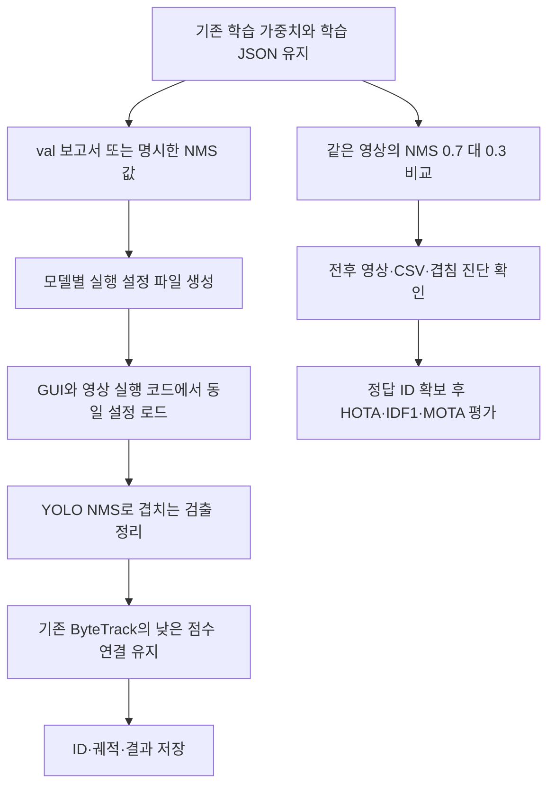

# 보호색 GUI의 NMS 적용과 전후 검증

기존 GUI에서 한 동물로 보이는 대상에 `보1`, `보2`가 동시에 표시되는 사례가 확인됐습니다.
원인이 검출 중복인지 추적 연결인지 한 화면만으로 확정할 수 없습니다.
이 브랜치는 검출 단계의 NMS를 명시적으로 제어하고 같은 영상의 전후 출력을 남깁니다.
공통 GUI·파이프라인·ByteTrack·한글 확장 코드는 변경하지 않습니다.



| 파일 | 역할 |
|---|---|
| `extensions/camouflage.py` | 선택적 실행 설정 검사·가중치 해시 확인·기존 모델에 NMS 인자 전달. GUI도 같은 경로 사용 |
| `configure_camouflage_inference.py` | 학습 원본을 보존하며 `camouflage.inference.json` 설치 |
| `run_camouflage.py` | `--nms-iou` 명시값 또는 모델 옆 설정으로 영상 추적·실효 검출 설정 기록 |
| `compare_camouflage_video.py` | 같은 영상·가중치·추적 설정으로 전후 영상 및 진단표 생성 |
| `compare_camouflage_detection.py` | 기존 IoU 함수가 CSV의 튜플 좌표도 처리하도록 보완 |
| `evaluate_camouflage.py`, `tune_camouflage.py` | 기존 정답 기반 평가·튜닝 보고서에 검출 설정 기록 |
| `tests/test_camouflage_nms.py` | 실제 NMS·ByteTrack과 합성 검출 제안으로 연결·보존·실패 처리 검사 |

## 설정 원칙

사용자의 #13 val 결과 최고 후보는 conf=0.2, NMS IoU=0.3, 검출 F1 약 0.598입니다.
이 결과는 후보 내 검출 설정 비교이며 추적 성능 개선 수치가 아닙니다.
이번 변경은 **NMS만** 적용합니다. 기존 기본 추적 설정의 low=0.05, high=0.4, new=0.5를 유지합니다.
모델 JSON에 별도 추적 설정이 있다면 해당 설정을 그대로 사용합니다.
따라서 #13의 conf=0.2 검출 F1을 그대로 재현하는 실험이 아닙니다.
NMS가 강하면 가까이 겹친 실제 두 동물을 제거할 수도 있어 다중 객체 영상도 검토해야 합니다.

실행 설정이 없으면 기존 동작을 유지합니다. 설치 파일은 모델 가중치 SHA256에 묶여 다른 모델에 재사용할 수 없습니다.
GUI 실행 중 설정 변경은 반영되지 않으므로 GUI를 완전히 종료하고 재실행합니다.
GUI의 일반 '설정 저장'에는 이 별도 파일이 포함되지 않습니다. 모델과 함께 보관하세요.
GUI 상단의 기본 검출 모델·추적기 선택은 보호색 전용 설정을 대신하지 않습니다.

## Windows / VS Code에서 새 브랜치 받기

VS Code는 Git 브랜치의 코드를 그대로 열고 실행할 수 있습니다. 이 브랜치는 #13까지의 코드를 포함합니다.
기존 PC 폴더가 ZIP 다운로드여서 `.git`이 없다면 `git fetch`는 사용할 수 없습니다.
기존 폴더를 남겨 두고 **아직 존재하지 않는 새 경로**에 복제하는 방법을 권장합니다.

```powershell
git clone --branch feature/camouflage-nms-validation https://github.com/kumohyunho/AI_Project_Level_3-main.git C:\AI\camouflage-code
code C:\AI\camouflage-code
```

`C:\AI\camouflage-code`가 이미 있다면 새로운 이름을 지정하세요.
실제 Git 저장소를 사용 중이고 작업 내용이 보존된 상태라면 프로젝트에서 다음으로 전환할 수 있습니다.

```powershell
git status
git fetch origin
git switch feature/camouflage-nms-validation
```

로컬 수정 내용이 있다고 경고되면 강제 전환하지 마세요. 로컬에서 직접 바꾼 파일은 자동으로 GitHub에 포함되지 않습니다.
현재 이 브랜치에는 사용자가 제공한 첫 학습 모델 `models/camouflage.pt`와 같은 학습의 `models/camouflage.json`이 포함되어 있습니다.
새로 clone하거나 브랜치를 ZIP으로 내려받으면 두 파일도 함께 받아지므로 Drive에서 매번 복사할 필요가 없습니다.
가중치는 5,447,834바이트이며 JSON에 기록된 SHA256과 일치합니다. 3에폭 모델로 추가 재학습한 파일이 아닙니다.
기존 Git 작업 폴더에 같은 이름의 미추적 모델 파일이 있으면 업데이트를 막을 수 있으므로 먼저 별도 폴더에 보관하세요.
테스트 원본 영상 `cuttlefish_test.mp4`는 프로젝트 최상위에 복사합니다.
기존 `C:\AI\camouflage-venv\Scripts\python.exe` 환경을 재사용할 수 있고 새 의존성 설치는 필요 없습니다.
VS Code의 인터프리터도 이 경로를 선택하고 '터미널에서 Python 파일 실행'을 사용합니다.

## 1. 같은 영상으로 변경 전후 확인

프로젝트 터미널에서 실행합니다. 아래의 결과 경로는 아직 존재하지 않아야 합니다.

```powershell
C:\AI\camouflage-venv\Scripts\python.exe compare_camouflage_video.py --video cuttlefish_test.mp4 --weights models/camouflage.pt --device cpu --output results/camouflage/nms_compare_01
```

기본 비교는 NMS 0.7 → 0.3입니다. 추적 신뢰도·가중치·원본 영상은 동일하게 유지합니다.
각 후보에서 추적기를 새로 만듭니다. 기존의 실행 설정 파일이 있어도 이 비교는 NMS 값을 명시해 실행합니다.
전체 비교가 성공한 뒤에만 결과 폴더를 게시하며 기존 결과는 덮어쓰지 않습니다.

```text
results/camouflage/nms_compare_01/
  before/tracked.mp4
  before/tracks.csv
  before/tracks.json
  after/tracked.mp4
  after/tracks.csv
  after/tracks.json
  comparison.csv
  comparison.json
```

| 진단 항목 | 의미와 주의점 |
|---|---|
| `unique_ids` | 영상에서 출력된 ID 수. 실제 동물 수나 ID Switches가 아님 |
| `empty_frames` | 출력 트랙이 없는 프레임 수. 가림·화면 이탈·미검출 모두 가능 |
| `multiple_tracks_frames` | 두 개 이상 트랙이 동시에 표시된 프레임 수 |
| `overlap_frames`, `overlap_pairs` | 출력 박스 IoU 0.5 이상인 프레임·트랙 쌍 수. 실제 다중 동물도 포함 가능 |
| `example_overlap_frames` | 눈으로 확인할 겹침 사례 프레임 번호, 최대 20개 |

전후 MP4를 같은 시점에서 비교해 박스가 잘 맞는지, ID가 유지되는지, 실제 두 동물을 놓치지 않는지 확인합니다.
겹침이나 ID 수가 줄어도 동물을 아예 놓친 결과일 수 있으므로 자동으로 개선 판정을 내리지 않습니다.
이 명령은 GUI 전체가 아니라 **GUI와 같은 보호색 확장 경로**를 비교합니다. 기본 COCO 검출·얼굴 모자이크는 포함하지 않습니다.
짧은 영상의 처리 속도는 첫 추론 초기화 영향을 받으므로 속도 개선 근거로 쓰지 않습니다.
MoCA 프레임에서 만든 영상의 24fps는 임시값이므로 실제 동물 속도를 평가하지 않습니다.

## 2. GUI에 NMS 설정 설치

현재 사용자 val 결과에 근거해 NMS 0.3을 명시하려면:

```powershell
C:\AI\camouflage-venv\Scripts\python.exe configure_camouflage_inference.py --weights models/camouflage.pt --nms-iou 0.3
```

#13의 `summary.json`만 Drive에서 내려받았다면 모델 일치·val 분할·해상도를 확인한 뒤 설치할 수도 있습니다.
두 설치 방법 중 하나만 사용하세요.

```powershell
C:\AI\camouflage-venv\Scripts\python.exe configure_camouflage_inference.py --weights models/camouflage.pt --report summary.json
```

```text
models/
  camouflage.pt              기존 학습 가중치
  camouflage.json            기존 학습 정보
  camouflage.inference.json  이번에 생성한 별도 실행 설정
```

기존 설정 파일은 덮어쓰지 않습니다. 모델을 바꾸거나 다시 비교해 설정을 바꿀 때는 기존 파일을 보관한 뒤 새로 생성합니다.

```powershell
C:\AI\camouflage-venv\Scripts\python.exe main.py
```

GUI를 새로 열고 보호색 동물 체크 → 원본 영상 열기 → 시작으로 확인합니다.
기본 대상·얼굴 모자이크를 끄면 보호색 결과에 집중할 수 있습니다.
기존 설정으로 되돌리려면 GUI 종료 후 별도 실행 설정만 다른 이름으로 보관합니다.

```powershell
Rename-Item models/camouflage.inference.json camouflage.inference.json.bak
```

## 정확도 검증과 사실 확인 범위

* 검출 정확도: 기존 #13을 동일 val 정답으로 실행하고 Precision·Recall·F1을 비교합니다. 설정 선택에 test를 쓰지 않습니다.
* 추적 정확도: 개체 ID를 실제로 검토·주석화한 데이터로 기존 `evaluate_camouflage.py`를 실행합니다.
  HOTA·IDF1·MOTA·ID Switches로 비교해야 하며 ID 미확인 경고 141개가 있는 현재 데이터로 숫자를 만들지 않습니다.
* 추적 튜닝: NMS를 바꾼 뒤에는 검출 입력이 달라지므로 기존 튜닝 결과를 최적이라고 가정하지 말고 val에서 다시 평가합니다.
* 자동 검사: 합성 제안에 torchvision NMS와 실제 ByteTrack을 사용해 NMS 전달, 낮은 점수 ID 유지,
  가림 후 복귀, 떨어진 두 객체, GUI 파이프라인 경유, 해시·출력 보존을 검사합니다.
  테스트 통과는 실제 동물 영상의 개선 근거가 아닙니다.
* 실제 사용자 모델·PC GUI의 변경 후 영상·추적 지표는 이 작업 환경에서 미실행입니다.
  제공된 화면만으로 중복 원인이 NMS라고 확정하지 않으며 개선율·추적 정확도를 추정하지 않습니다.

검출 비교·추적 입력·실제 동물 정확도를 구분하고, 실제로 실행한 항목과 미실행 항목을 보고합니다.
전체 학습 데이터나 3.3GB 백업을 PC에 다운로드할 필요는 없습니다.

이 작업 환경에서 전체 unittest 104개가 통과했습니다. 변경 Python 파일의 Ruff F/E9 검사와 diff 공백 검사도 통과했습니다.
설치된 Ultralytics 8.3.233의 기본 NMS IoU가 0.7, max_det이 300인 것도 실제 설정으로 확인했습니다.
검사한 범위에서 새 코드의 미사용 import·변수는 발견되지 않았고 생성 데이터·테스트 영상은 커밋하지 않습니다.
이후 사용자가 제공한 모델·설정 쌍을 같은 브랜치에 추가했습니다. 원본 바이트를 보존하고 모델 SHA256·체크포인트 ZIP CRC를 검사했습니다.
해당 실제 모델을 CPU에서 로드하고 빈 640×640 프레임 1장의 검출·추적 실행까지 확인했습니다. 이는 실제 동물 영상의 정확도 평가가 아닙니다.
