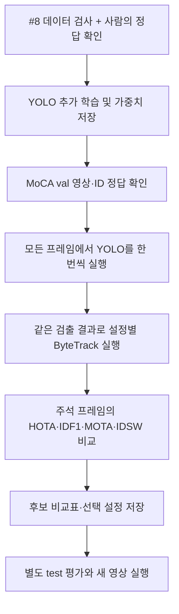

# 보호색 동물 추적 설정 튜닝

#8은 **전처리 데이터 구조 검사와 정답 미리보기**를 만들었습니다. 이번 단계는 그 코드를 포함하는
`feature/camouflage-tuning` 브랜치에서 **검증 영상의 추적 설정 비교·선택**을 추가합니다.
기존 브랜치와 PR #7·#8은 변경하거나 병합하지 않습니다.

## 순서와 코드 역할



| 코드 | 역할 |
|---|---|
| `inspect_camouflage_data.py` (기존 #8) | 학습 전 데이터 구조 검사와 사람의 검토 자료 생성 |
| `tune_camouflage.py` (추가) | val 확인, 검출 재사용, 설정 비교·선택·결과 저장 |
| `evaluate_camouflage.py` (보완) | 튜닝과 주석 검사 함수를 공유하고 선택 설정으로 test 평가 |
| `extensions/camouflage.py` (보완) | 설정 JSON 읽기, 해시가 있는 경우 사용 가중치 일치 확인 |
| `run_camouflage.py` (보완) | `--tracker-config`로 선택 설정을 새 영상·카메라에 적용 |
| `tests/test_tune_camouflage.py` (추가) | 가짜 검출기와 실제 ByteTrack·지표로 탐색·재사용·오류 차단 검증 |

**YOLO 가중치를 학습하는 코드가 아닙니다.** 학습된 검출기를 고정하고 추적 연결 설정을 고릅니다.
현재 실제 COD10K/MoCA·학습된 보호색 가중치가 없으므로 실제 튜닝·성능 검증은 미실행입니다.

## 실행

#8 검사기와 원본 영상으로 정답을 확인하고 `train_camouflage.py`로 전용 모델을 학습한 뒤 실행합니다.
`models/camouflage.pt`와 `.json`, ID가 확인된 val 시퀀스가 필요합니다.

```bash
python tune_camouflage.py datasets/camouflage/tracking/val --weights models/camouflage.pt --device cpu --output results/camouflage/tuning
```

GPU에서는 `--device 0`. 작은 탐색 예:

```bash
python tune_camouflage.py datasets/camouflage/tracking/val --high 0.4 0.5 --match 0.7 0.8 --buffer 30 60 --output results/camouflage/tuning-small
```

| 파라미터 | 기본 탐색 값 | 의미 |
|---|---|---|
| `high_thresh` | 0.4, 0.5, 0.6 | 높은 신뢰도 검출 기준 |
| `new_track_thresh` | high + 0.1, 최대 1 | 새 ID 생성 기준, high에 연동 |
| `match_thresh` | 0.7, 0.8, 0.9 | 1차 연결 비용 상한. 클수록 더 높은 비용도 허용 |
| `track_buffer` | 30, 60, 90 | 트랙 유지 프레임(30fps 기준, 실제 FPS로 환산) |

low_thresh·외형/복원 옵션은 모델 JSON의 기존 설정을 유지하며 `--base-config`로 시작 설정을 바꿀 수 있습니다.
기존 설정은 항상 후보 0으로 포함하고 중복은 제거합니다. 기본 격자 27개에 기존 설정이 없다면 후보가 하나 추가됩니다.
격자 입력은 최대 255조합, 기존 설정 포함 최대 256개입니다.

* 전 프레임을 순서대로 추적하고 **주석 프레임에서만 평가**합니다. 미주석 프레임을 음성 정답으로 만들지 않습니다.
* YOLO는 각 프레임에서 한 번만 호출합니다. 기존 low_thresh부터 저신뢰도 검출도 보관해 후보별 점수 분리가 가능합니다.
* 실행 중 메모리에 박스·점수·클래스·필요시 외형 특징만 보관합니다. 프레임 이미지나 재실행용 디스크 캐시는 저장하지 않습니다.
  긴 영상·많은 검출에서는 캐시 메모리가 커질 수 있습니다.
* 후보마다 영상마다 새 추적기를 만들므로 이전 후보의 ID/상태를 물려받지 않습니다.
* **HOTA 최대 → IDF1 최대 → MOTA 최대 → IDSW 최소** 순서로 선택. 모두 동점이면 기존 설정, 이후 입력 순서를 우선합니다.
* test/train, ID 미확인, 빈 정답, 잘못된 프레임·FPS·박스·검출 결과는 거부합니다.
  파일의 분할 선언을 확인할 뿐 원본 영상 출처나 주석 의미를 증명하지 않습니다.

## 출력과 적용

| 결과 | 내용 |
|---|---|
| `summary.json` | 모든 후보·기존/선택 설정·변화량·입력 해시·평가 범위 |
| `best_config.json` | 선택 설정·사용 모델 해시·val 지표 |
| `comparison.csv`, `comparison.md` | 후보별 성능 비교표 |

성공 후에만 최종 폴더로 저장하고 기존 출력은 덮어쓰지 않습니다. 모델·학습 설정·정답·주석 명세·해독한
전체 이미지 스트림의 SHA256을 기록합니다. 해시가 정답의 정확성이나 데이터 누수 부재를 증명하지는 않습니다.

```bash
python evaluate_camouflage.py datasets/camouflage/tracking/test --tracker-config results/camouflage/tuning/best_config.json --output results/camouflage/tuned-test
python run_camouflage.py --video new_animal.mp4 --tracker-config results/camouflage/tuning/best_config.json --output results/camouflage/tuned-video
```

모델 경로가 다르면 두 명령에도 같은 `--weights`를 지정하세요. 해시가 있는 튜닝 설정은 모델이 다르면 중단합니다.
해시가 없는 순수 TrackerConfig JSON에는 이 검사를 적용할 수 없습니다.
GUI 설정은 자동 변경하지 않습니다. GUI 적용 시 모델 JSON을 백업하고 `tracker`에 선택 설정을 넣습니다.

## 테스트·사실 확인 범위

`python -m unittest discover -s tests -t .`으로 검사합니다. 가짜 검출기·임시 MoCA 형식 데이터와 실제 ByteTrack·지표를 사용합니다.
검출 호출 횟수, 동점 시 기존 설정 유지, 더 나은 후보 선택, test/train 차단, 캐시 보존, 희소 평가, MOT 좌표계,
파일 평가와 지표 일치, 설정 재사용·모델 불일치, 실패 시 출력 보존을 확인합니다.
합성 픽스처 점수를 실제 동물 정확도나 개선 성능으로 보고하지 않습니다.

검증 값은 이번 val 데이터와 격자에서만 유효하며 전체 최적값이나 새 영상의 개선을 보장하지 않습니다.
캐시 탐색 속도를 실시간 FPS로 보고하지 않습니다. test 결과를 보고 재조정하면 새로운 test가 필요합니다.
실제 보호색 여부·동물 종·ID 의미·실동물 성능은 검증하지 않으며 ‘환각 없음’을 보장하지 않습니다.

이번 변경의 점검 결과:

* 기존 기능 포함 **78개 테스트 통과**, 새 튜닝 테스트 **14개**. 수치 연산 스레드를 제한한 환경에서 실행했습니다.
* 변경 Python 코드·테스트의 `ruff check --select F,E9`, 문법·CLI 도움말·git diff 공백 검사 통과.
* 전체 저장소 정적 검사에서는 기존 `main.py`의 미사용 `STATUS_EXITED`, `STATUS_OCCLUDED` import 2개만 발견했습니다.
  공통 GUI 파일은 수정하지 않았습니다. 정적 검사가 모든 불필요한 코드·파일을 찾았다는 뜻은 아닙니다.
* 평가·영상 실행의 설정 읽기와 주석 검사를 재사용하도록 정리했습니다. 새 런타임 패키지는 추가하지 않았습니다.
* 검출 캐시·가짜 가중치·임시 데이터·비교 결과·로그는 커밋하지 않습니다.
* 실제 COD10K/MoCA 폴더와 `models/camouflage.pt`가 없음을 확인했습니다. 실제 튜닝·학습·실동물 개선 수치는 미실행입니다.
