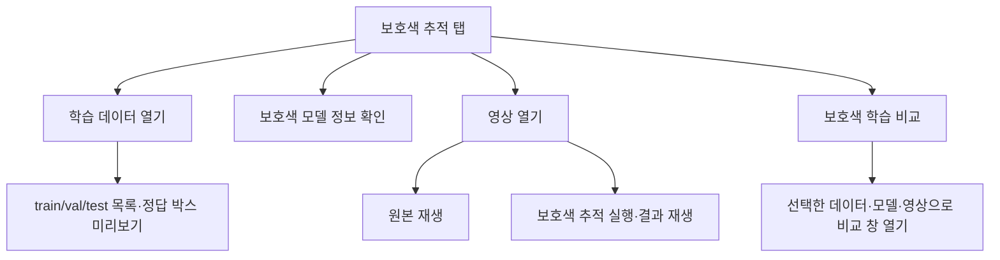

# 보호색 추적 전용 화면

상단 탐색을 **실시간 추적 → 성능 비교 → 보호색 추적** 순서로 구성합니다.
기존 제목 옆의 '보호색 학습 비교' 버튼은 보호색 추적 화면 안으로 옮깁니다.
전용 화면 자체와 공통 main.py 연결은 저장소 규칙에 따라 별도 PR로 나눕니다.



| 화면 기능 | 사용 방법 |
|---|---|
| 학습 데이터 열기 | 전처리 데이터의 `dataset.yaml` 또는 `splits.json` 선택. 분할을 바꾸고 이미지 행을 클릭 |
| 정답 박스 미리보기 | 녹색 GT 박스는 YOLO 정답 라벨에서 읽은 값. 검출 결과나 추적 ID가 아님 |
| 보호색 모델 열기 | `.pt` 선택. 같은 폴더·이름의 학습 `.json` 필요. 모델 해시와 실행 설정 검사 |
| 모델 정보 | 기록된 에폭·초기 학습률·val mAP50·현재 NMS 표시. 과거 학습 기록이며 재측정값이 아님 |
| 영상 열기·원본 재생 | 사용자가 선택한 원본 영상 재생·일시정지·구간 이동 |
| 보호색 추적 실행 | 선택한 모델로 별도 프로세스에서 처리. CPU 또는 GPU 0 선택. 완료 후 박스·ID·궤적 영상 재생 |
| 중지 | 재생 중지 및 실행 중인 추적 처리 중지. 부분 영상을 완료 결과로 표시하지 않음 |
| 보호색 학습 비교 | 해당 탭에서 선택한 데이터·모델·영상 경로를 기존 학습률 비교 창에 전달 |

## 데이터와 실행 환경

코드에는 기존 학습 모델 쌍이 포함되어 있지만 데이터셋과 사용자의 영상은 포함되어 있지 않습니다.
데이터가 없어도 모델·원본 영상으로 추적할 수 있습니다. 정답 미리보기와 재학습에는 실제 이미지·라벨이 필요합니다.
데이터를 새 브랜치 폴더에 매번 복사할 필요 없이 기존 폴더의 `dataset.yaml`을 선택해 사용할 수 있습니다.
경로에 예전 Colab 원본 위치가 남아 있어도 미리보기는 선택한 명세 옆의 images/labels 상대 경로를 사용합니다.
재학습은 기존 학습률 비교 코드가 별도 실행 YAML을 만들어 처리합니다.

```text
선택한 데이터 폴더/
  dataset.yaml
  splits.json
  images/train, images/val, images/test
  labels/train, labels/val, labels/test
```

데이터 목록은 명세에 등록된 이미지 수입니다. 실제 파일·좌표는 선택한 이미지의 미리보기에서 확인합니다.
파일이 없으면 누락 상태를 표시하며 다른 이미지나 가짜 정답으로 대체하지 않습니다.
전체 데이터 검사는 기존 `inspect_camouflage_data.py`가 필요하고, 실제 동물 종류·개체 ID의 의미는 별도 검토가 필요합니다.

## 추적 결과

```text
runs/camouflage/gui_<식별자>/
  tracked.mp4
  tracks.csv
  tracks.json
```

현재 전용 화면은 영상을 처리한 뒤 완성된 결과를 재생하는 방식입니다. 처리 중 프레임을 실시간으로 보여주는 방식은 아닙니다.
기존 실시간 추적 탭은 계속 사용할 수 있습니다. 보호색 전용 처리는 COCO 기본 검출과 얼굴 모자이크를 실행하지 않습니다.
모델 옆 `camouflage.inference.json`이 있으면 NMS 설정을 사용하며 없으면 기존 기본값을 사용합니다.
모델이나 원본 영상을 바꾸면 이전 결과 선택을 해제해 서로 다른 조건의 결과를 혼동하지 않도록 합니다.
학습 가중치·학습 JSON·정답 파일은 수정하지 않습니다. 새 의존성은 없습니다.

전용 화면 단독 실행:

```powershell
C:\AI\camouflage-venv\Scripts\python.exe camouflage_tracking_page.py
```

최종 연결 브랜치에서는 기존처럼 `main.py`를 실행하고 '보호색 추적' 탭을 누릅니다.
Python 경로는 실제 설치한 가상환경에 맞춰 사용하세요.

## 검사 범위

합성 이미지·라벨로 분할 전환·정답 미리보기·원본 보존·잘못된 경로/라벨 검사를 수행합니다.
Qt에서 모델 기록 표시·학습 비교 경로 전달·별도 처리 프로세스 실행/중지·미완성 결과 차단을 검사합니다.
이 검사는 실제 동물 추적 정확도나 Windows 코덱 호환성 검증을 대신하지 않습니다.
새 화면은 데이터를 재학습하거나 과거 성능을 다시 측정하지 않으며 실제 정확도 개선 수치를 만들어 표시하지 않습니다.
전체 unittest 119개가 통과했습니다. 새 코드의 미사용 import·변수·구문 검사와 diff 공백 검사도 통과했습니다.
별도로 업로드된 실제 모델로 짧은 합성 영상을 처리하고 결과 MP4·CSV·JSON 및 새 화면의 영상 프레임 수신을 확인했습니다.
실제 동물 영상의 추적 정확도와 Windows GUI 재생은 이 환경에서 미실행입니다.
